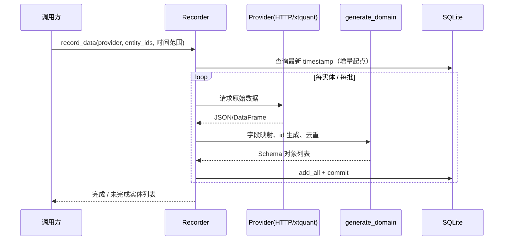
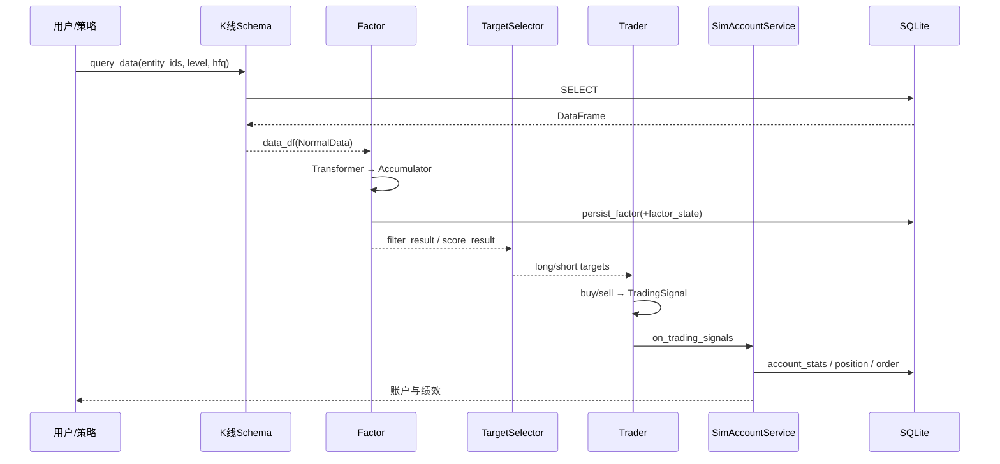

# ZVT 系统架构、功能与数据逻辑

> 本文基于 `g:\GitHub\zvt` 仓库源码整理，覆盖文档体系、代码模块、核心功能与端到端数据链路，供二次开发、运维与文档编写参考。

## 1. 文档结构

### 1.1 现有文档（Sphinx）

现有文档位于 `docs/`，使用 Sphinx + reStructuredText，入口为 `docs/source/index.rst`：

```text
docs/
├── Makefile / make.bat
├── architecture.md               # 本文：架构、功能与数据逻辑
├── storage_config.md             # 存储路径/路由配置说明
└── source/
    ├── conf.py                     # Sphinx 配置（autodoc、主题、扩展）
    ├── index.rst                   # 文档首页与 toctree
    ├── intro.rst                   # 项目定位与能力介绍
    ├── install.rst                 # 安装说明
    ├── usage.rst                   # 快速上手
    ├── core_concepts.rst           # 核心概念（Entity/Schema/Factor/Trader...）
    ├── contributor.rst             # 贡献指南
    ├── api/
    │   └── index.rst               # 便捷查询 API（api 包）
    ├── data/
    │   ├── index.rst               # 数据层导航
    │   ├── data_concepts.rst       # TradableEntity/Actor/Schema/Kdata/IntervalLevel
    │   ├── adding_new_entity.rst   # 新增标的类型
    │   ├── extending_data.rst      # 扩展数据
    │   ├── record_and_query.rst    # record_data / query_data 详解
    │   └── trading_anything.rst    # 任意标的交易
    ├── drawer/
    │   ├── index.rst
    │   └── drawer_concepts.rst     # 可视化绘制
    ├── factor/
    │   ├── index.rst
    │   ├── factor_concepts.rst     # Factor/Transformer/Accumulator/NormalData
    │   └── extending_factor.rst    # 自定义因子
    ├── ml/
    │   └── index.rst               # 机器学习
    ├── trader/
    │   ├── index.rst
    │   └── trader_concepts.rst     # 回测/交易
    ├── _static/                    # 概念图（data_structure.png、factor_flow.png 等）
    └── _templates/                 # autodoc 模板
```

**文档特点与缺口**

| 维度 | 现状 | 缺口 |
| --- | --- | --- |
| 概念 | 较完整（data/factor/trader/ml） | 缺少统一架构总览与模块边界说明 |
| 数据层 | 有 record/query 与表命名规范 | 缺少存储路由、schema_providers、增量策略的完整说明 |
| 因子 | 有 Factor/Transformer/Accumulator 概念 | 缺少因子持久化、状态恢复、内置因子清单 |
| 交易 | 有 Trader 概念 | 缺少模拟账户、QMT 实盘、交易计划的字段与流程 |
| 服务层 | 无 | 缺少 REST API、Dash UI、定时任务说明 |
| 运维 | 无 | 缺少数据库目录、日志、备份与排障 |

### 1.2 建议的文档目录（按层组织）

```text
docs/source/
├── overview/
│   ├── architecture.rst            # 分层架构与模块职责（本文对应）
│   ├── concepts.rst                # 核心概念与术语表
│   └── glossary.rst                # entity_id / table / factor 命名约定
├── data/
│   ├── storage.rst                 # ZVT_HOME、storage_id、路由与配置
│   ├── schema.rst                  # Mixin/Entity/Portfolio/... 基类
│   ├── recorders.rst               # Recorder 体系与增量采集
│   ├── query.rst                   # get_data/query_data 与返回值
│   └── assets.rst                  # 各子域数据字典（表与字段）
├── factor/
│   ├── framework.rst               # Factor 生命周期
│   ├── builtin.rst                 # ma/macd/zen/fundamental 因子
│   └── persist.rst                 # 因子表与 factor_state
├── strategy/
│   ├── selector.rst                # TargetSelector 与信号
│   └── ml.rst                      # MLMachine
├── trading/
│   ├── backtest.rst                # Trader + SimAccountService
│   ├── live_qmt.rst                # QMT 账户与行情
│   └── plan.rst                    # TradingPlan / TagQuoteStats
├── service/
│   ├── rest.rst                    # FastAPI 路由
│   ├── ui.rst                      # Dash 应用
│   └── tasks.rst                   # 定时任务编排
└── ops/
    ├── config.rst                  # config.json 全量字段
    └── troubleshooting.rst         # 常见问题
```

### 1.3 本文定位

本文对应上述 `overview/architecture` 与各层“实现细节”部分，重点回答三个问题：

1. **系统由哪些模块组成，各自职责是什么**（第 2、3、4 章）
2. **数据如何从外部数据源进入本地库，再被查询和计算**（第 5、6 章）
3. **因子如何变成信号，信号如何变成交易与统计结果**（第 7～11 章）

---

## 2. 系统总览

### 2.1 定位与技术栈

ZVT 是一个面向 A 股/港股/美股、ETF、指数、期货、可转债的**量化数据 + 因子 + 选股 + 回测 + 实盘**一体化框架。

| 层次 | 技术 |
| --- | --- |
| 语言/运行时 | Python 3 |
| 数据存储 | SQLAlchemy + SQLite（可扩展 StorageBackend） |
| 计算 | pandas / numpy / scikit-learn |
| 服务 | FastAPI + uvicorn（端口 8090） |
| 可视化 | Dash / Plotly |
| 实盘 | QMT（xtquant，Windows） |

### 2.2 分层架构

```mermaid
flowchart TD
    subgraph 外部数据源
        EM[东方财富 em/eastmoney]
        JQ[聚宽 joinquant]
        SINA[新浪 sina]
        JQKA[同花顺 jqka]
        EX[交易所 exchange]
        QMT[QMT 行情/交易]
        WB[世界银行 wb]
    end

    subgraph 采集层
        REC[recorders/*<br/>Recorder 子类]
    end

    subgraph 存储层
        STO[contract/storage.py<br/>StorageBackend]
        DB[(SQLite<br/>data/{provider}/{provider}_{db}.db)]
    end

    subgraph 领域模型
        DOM[domain/*<br/>Schema 定义]
    end

    subgraph 计算层
        FAC[factors/*<br/>Factor/Transformer/Accumulator]
        ML[ml/*<br/>MLMachine]
        TS[factors/target_selector.py]
    end

    subgraph 交易层
        TRD[trader/*<br/>Trader + SimAccountService]
        LIVE[trading/* + broker/qmt<br/>TradingPlan + 实盘]
    end

    subgraph 服务层
        API[rest/* FastAPI]
        UI[ui/* Dash]
        TASK[tasks/* 定时任务]
    end

    EM --> REC
    JQ --> REC
    SINA --> REC
    JQKA --> REC
    EX --> REC
    QMT --> REC
    WB --> REC
    REC -->|generate_domain + persist| STO
    STO --> DB
    DOM --> REC
    DOM --> STO
    DB --> FAC
    DB --> TRD
    DB --> API
    FAC --> TS
    FAC --> ML
    TS --> TRD
    ML --> TRD
    TRD --> LIVE
    FAC --> API
    LIVE --> API
    API --> UI
    TASK --> REC
    TASK --> LIVE
```

### 2.3 代码目录

```text
src/zvt/
├── __init__.py              # 环境初始化：ZVT_HOME、data/resource/tmp/ui/log、config、插件
├── config.json              # 默认配置（账号、代理、storage、schema_providers）
├── consts.py                # ZVT_HOME / 测试目录 / 样例代码与指数
├── zvt_server.py            # FastAPI 入口
├── contract/                # 核心抽象：api、storage、route_registry、recorder、factor、schema
├── domain/                  # 数据 Schema（meta/quotes/fundamental/macro/emotion/actor/misc）
├── recorders/               # 各数据源的 Recorder 实现
├── factors/                 # 因子框架与内置因子（ma/macd/zen/fundamental）
├── api/                     # 便捷查询与统计（kdata、selector、stats、portfolio、intent）
├── trader/                  # 回测引擎、模拟账户、交易 schema
├── trading/                 # 交易计划、标签行情统计、实盘服务
├── tag/                     # 标签体系与动态标的池
├── ml/                      # 机器学习
├── rest/                    # FastAPI 路由（data/factor/work/trading/misc）
├── ui/                      # Dash 应用
├── broker/qmt/              # QMT 行情与账户适配
├── tasks/                   # 运营脚本（标签初始化、股票池、QMT 采集）
├── sched/                   # 定时调度入口
├── informer/                # 消息/通知
├── autocode/                # 自动生成代码/模板
├── misc/ common/ utils/     # 通用工具
└── samples/                 # 测试样例数据
```

---

## 3. 核心概念

| 概念 | 定义 | 代表代码 |
| --- | --- | --- |
| Entity | 可被描述的存在，如股票、指数、ETF、板块 | `domain/meta/*`，`Stock`、`Index`、`Etf`、`Block` |
| TradableEntity | 可交易标的；提供交易日、交易时段、T+1 等规则 | [schema.py](../src/zvt/contract/schema.py) `TradableEntity` |
| ActorEntity | 市场主体，如基金、机构、个人、政府 | `ActorMeta`、`StockActorSummary` |
| Schema | 数据表结构，一个 Schema 可对应多个 provider 的存储 | `domain/**`，均继承 `Mixin` |
| Provider | 数据来源标识，如 `em`、`joinquant`、`qmt` | `recorders/*` |
| Storage | 物理存储（默认 SQLite 文件） | [storage.py](../src/zvt/contract/storage.py) |
| Recorder | 按 Schema 抓取并落库的执行器 | [recorder.py](../src/zvt/contract/recorder.py) |
| Factor | 从行情/财务等数据计算出的市场描述，可持久化为新 Schema | [factor.py](../src/zvt/contract/factor.py) |
| TargetSelector | 按因子结果筛选做多/做空目标 | [target_selector.py](../src/zvt/factors/target_selector.py) |
| Trader | 回测引擎，消费因子/选股结果并驱动账户 | [trader.py](../src/zvt/trader/trader.py) |
| TradingSignal | 交易信号（开多/平多/开空/平空/保持） | [trader/__init__.py](../src/zvt/trader/__init__.py) |
| Tagger | 按维度给标的打标签，可作为特征或选股条件 | [tag_service.py](../src/zvt/tag/tag_service.py) |
| MLMachine | 机器学习引擎（特征、标签、训练、预测） | [ml/ml.py](../src/zvt/ml/ml.py) |
| NormalData | 双层索引（entity_id, timestamp）的 DataFrame 约定 | [normal_data.py](../src/zvt/contract/normal_data.py) |

**实体 ID 约定**

```text
entity_id = {entity_type}_{exchange}_{code}
例：stock_sz_000001 / index_sh_000300 / etf_sh_510300
```

**时间与复权约定**

- `timestamp`：事件发生时间；日线为当日 00:00，分钟线为区间结束时间。
- `IntervalLevel`：`tick/1m/5m/15m/30m/1h/4h/1d/1wk/1mon`。
- `AdjustType`：`qfq`（前复权）、`hfq`（后复权）、`bfq`（不复权）。
- 股票因子默认使用 `hfq`；非股票默认 `qfq`（见 [kdata.py](../src/zvt/api/kdata.py) `default_adjust_type`）。

---

## 4. 功能清单

| 功能域 | 能力 | 主要入口 |
| --- | --- | --- |
| 标的元数据 | 股票/指数/ETF/板块/基金/期货/可转债/港美股 | `domain/meta/*`、`Recorder` |
| 行情数据 | 日线到分钟线、Tick、实时报价 | `domain/quotes/*`、`recorders/em`、`recorders/qmt` |
| 财务与估值 | 三张表、财务因子、估值、融资融券 | `domain/fundamental/*`、`recorders/eastmoney` |
| 宏观 | GDP、货币供应、国债收益率 | `domain/macro/*`、`recorders/wb`、`recorders/em` |
| 情绪/资金 | 涨跌停、龙虎榜、资金流、新闻、热度 | `domain/emotion`、`domain/misc`、`recorders/jqka` |
| 因子计算 | MA、MACD、缠论、财务因子 | `factors/*` |
| 选股 | 因子组合、阈值筛选、排序 | `factors/target_selector.py`、`api/selector.py` |
| 机器学习 | 特征/标签/训练/预测 | `ml/ml.py` |
| 回测 | 多级别、信号驱动、模拟账户、绩效 | `trader/*` |
| 实盘 | QMT 行情采集、账户查询、买卖 | `broker/qmt/*`、`trading/*` |
| 标签体系 | 主标签/子标签/隐藏标签、股票池、标签统计 | `tag/*` |
| 服务 | REST API、Dash 看板、定时任务 | `rest/*`、`ui/*`、`tasks/*` |

---

## 5. 数据层逻辑

### 5.1 环境与目录

系统启动时 [__init__.py](../src/zvt/__init__.py) 调用 `init_env()`：

```text
ZVT_HOME = 环境变量 ZVT_HOME，否则 ~/zvt-home
└── zvt-home/
    ├── data/          # 数据库根目录（zvt_env["data_path"]）
    ├── resources/     # 内置资源复制（日志配置等）
    ├── tmp/           # 临时文件
    ├── ui/            # UI 输出
    ├── logs/          # 日志目录（zvt_env["log_path"]）
    └── config.json    # 用户配置（首次从包内 config.json 复制）
```

`init_log()` 默认把 `zvt.log` 写在**当前工作目录**（`RotatingFileHandler`，单文件 500MB、保留 10 份）；`zvt_env["log_path"]` 只是日志目录约定，业务脚本通常显式传入日志文件名。

测试模式设置 `TESTING_ZVT` 时使用 `~/zvt-test-home`，并解压 `samples/data.zip`。

### 5.2 存储标识与路由

**核心链路**

```text
(data_schema, provider)
   → db_name        （由 register_schema 注册到 zvt_context.dbname_map_base）
   → storage_id     （RouteRegistry：默认 "{provider}_{db_name}"，可配置覆盖）
   → 文件路径        （SqliteStorageBackend：默认 "{data_path}/{provider}/{provider}_{db_name}.db"）
   → SQLAlchemy Engine / Session
```

相关实现：

- [api.py](../src/zvt/contract/api.py) `get_db_engine()` / `get_db_session()`：解析 db_name、路由、懒初始化表与索引。
- [storage.py](../src/zvt/contract/storage.py) `SqliteStorageBackend`：`storage_id.split("_", 1)` 得到 provider 与 db_name，创建 provider 子目录。
- [route_registry.py](../src/zvt/contract/route_registry.py) `RouteRegistry.get_storage_id()`：优先级为“程序注册 > 配置 `storage_routes` > 默认规则”。

**config.json 中的 storage 配置**

```json
{
  "storage": {
    "base_path": null,
    "path_template": null,
    "storage_routes": {},
    "schema_providers": {
      "zvt_info": ["zvt"],
      "trader_info": ["zvt"],
      "stock_tags": ["zvt"],
      "stock_trading": ["zvt"],
      "stock_1d_ma_factor": ["zvt"],
      "stock_1d_ma_stats_factor": ["zvt"],
      "stock_1d_zen_factor": ["zvt"],
      "stock_1wk_zen_factor": ["zvt"],
      "index_1d_zen_factor": ["zvt"],
      "top_stocks": ["zvt"],
      "stock_quote": ["qmt"],
      "stock_quote_log": ["qmt"]
    }
  }
}
```

- `base_path`：覆盖 `zvt_env["data_path"]`。
- `path_template`：自定义路径模板，占位符：`{base_path}`、`{provider}`、`{db_name}`、`{storage_id}`。
- `storage_routes`：键为 `provider|db_name`，值为 `storage_id`，用于把多个 provider/库路由到同一文件。
- `schema_providers`：**内部业务表**（无外部 Recorder）的默认 provider 列表；外部数据表通过 Recorder 注册自动获得 provider。

完整字段说明与配置示例见 [storage_config.md](../storage_config.md)。

### 5.3 表命名规范

| 类型 | 规则 | 示例 |
| --- | --- | --- |
| 标的元表 | `{entity_type}` / `{entity_type}_meta` | `stock`、`index`、`etf`、`block`、`fund`、`stock_detail` |
| K 线 | `{entity}_{level}[_{adjust}]_kdata` | `stock_1d_hfq_kdata`、`stock_30m_kdata`、`index_1wk_kdata` |
| 实时报价 | `{entity}_quote` / `{entity}_1m_quote` | `stock_quote`、`stock_1m_quote` |
| 财务 | 语义名 | `balance_sheet`、`income_statement`、`cash_flow_statement`、`finance_factor` |
| 估值 | 语义名 | `stock_valuation`、`etf_valuation` |
| 资金/情绪 | 语义名 | `stock_money_flow`、`limit_up_info`、`dragon_and_tiger` |
| 因子表 | `{entity}_{level}_{factor}_factor` | `stock_1d_ma_factor`、`stock_1d_zen_factor` |
| 内部业务 | 语义名 | `zvt_info`（`factor_state`）、`trader_info`、`stock_tags`、`stock_trading` |

> **qfq 例外**：为兼容历史数据，前复权的 adjust_type 在表名中留空，即 `stock_1d_kdata` 实际表示前复权日线；后复权为 `stock_1d_hfq_kdata`。
>
> **K 线 Schema 类名**：`{Entity}{Level}{Adjust}Kdata`，如 `Stock1dHfqKdata`、`Index1wkKdata`（见 [kdata.py](../src/zvt/api/kdata.py) `get_kdata_schema`）。

### 5.4 Schema 基类体系

[contract/schema.py](../src/zvt/contract/schema.py)：

```text
Mixin                      # id / entity_id / timestamp + query_data / record_data / get_storages
├── NormalMixin            # + created_timestamp / updated_timestamp
├── Entity                 # + entity_type / exchange / code / name / list_date / end_date
│   ├── TradableEntity     # + 交易日/交易时段/T+1/涨跌规则
│   │   ├── Portfolio      # 组合（Index/Etf/Block/Fund），有成分股关系
│   │   └── NormalEntityMixin
│   └── ActorEntity
├── PortfolioStock         # 组合→个股，含 report_period/proportion/shares/market_cap
└── TradableMeetActor      # 标的→参与者（如十大股东）
```

每个 Schema 通过 `register_schema(db_name=..., schema_base=..., entity_type=..., internal=...)` 注册到 `zvt_context`，形成：

- `dbname_map_base`：db_name → Declarative Base
- `dbname_map_schemas`：db_name → Schema 列表
- `tradable_schema_map`：entity_type → 标的 Schema
- `provider_map_dbnames`：provider → 数据库名列表

### 5.5 采集链路（Recorder）

**类体系**（[contract/recorder.py](../src/zvt/contract/recorder.py)）

```text
Recorder                     # 元数据/单次采集
└── EntityEventRecorder      # 按标的逐实体采集
    ├── TimeSeriesDataRecorder       # 时序事件，支持增量
    │   ├── FixedCycleDataRecorder   # 固定周期 K 线（按 level 采集）
    │   └── TimestampsDataRecorder   # 指定时间点采集（如财报）
```

**执行流程**

```text
Recorder.run()
  └─ while 未完成实体:
       ├─ evaluate_start_end_size_timestamps(entity)
       │    ├─ 取该实体已存最新记录时间（无则用上市日）
       │    ├─ 用 start_timestamp / end_timestamp 夹取区间
       │    ├─ 已到 end 或未上市 → size=0 表示完成
       │    └─ 返回 start、end、size（默认 2000 条/批）
       ├─ record(entity, start, end, size, timestamps)   # 子类实现抓取
       ├─ generate_domain(entity, item)                  # 原始数据 → Schema 对象
       │    ├─ id 生成：{entity_id}_{timestamp}
       │    ├─ 库中已存在同 id 且 force_update=False → 跳过
       │    └─ 批量内重复：fix_duplicate_way="add" 时追加 uuid，否则忽略
       ├─ persist(entity, domain_list)                   # session.add_all + commit
       └─ 无新数据/到收盘时间 → 标记完成
```

**关键默认值**

| 参数 | TimeSeriesDataRecorder | FixedCycleDataRecorder |
| --- | --- | --- |
| `force_update` | `False` | `True` |
| `sleeping_time` | 5 秒 | 10 秒 |
| `fix_duplicate_way` | `add` | `ignore` |
| `default_size` | 2000 | 2000 |
| `real_time` | `False` | `False` |

**K 线采集特例**：

- 从表名反解 `level` 与 `adjust_type`，并计算剩余天数/时间点；
- 增量起点会读取最近 2 条记录，若两条落在同一周期，说明最后一条是“未完成 K 线”，先删除再重采；
- 实时模式下以收盘时间（`entity_schema.get_close_hour_and_minute()`）之后 5 分钟作为结束条件。

**Provider 注册**：`Recorder.__init_subclass__` / `register_recorder_cls` 把 provider 绑定到 Schema，因此：

```python
Stock1dHfqKdata.get_providers()   # ['em', 'joinquant', ...]
Stock1dHfqKdata.record_data(provider="em")   # 找到对应 Recorder 并执行
```

### 5.6 查询链路

```text
Schema.query_data(...) / get_data(...)
  ├─ 解析 provider（未指定则取 get_providers()[0]）
  ├─ 解析 db_name → storage_id → engine/session
  ├─ 构造 SQLAlchemy Query：
  │    ids / entity_id(s) / code(s) / level / 时间区间 / filters / columns
  │    / order / limit / distinct
  ├─ 执行
  └─ 返回 df | domain | dict | select
```

要点：

- `index=["entity_id", "timestamp"]` 可直接得到因子计算所需的 `NormalData` 结构。
- `get_data` 支持 `col_label`（列改名）、`time_field`（自定义时间字段）、`drop_index_col`。
- 跨 level 查询由 `api/kdata.py` `get_kdata` 负责解析实体类型并选择 Schema；高周期可由 `to_high_level_kdata` 聚合生成。

### 5.7 写入与去重

[api.py](../src/zvt/contract/api.py) `df_to_db()`：

1. 去掉 `id` 重复行（`keep="last"`）并裁掉 Schema 之外的列；
2. 按主键检查已存在记录：`force_update=False` 时过滤掉已存在 id，`True` 时先 `DELETE` 再插入；
3. 分批写入：默认 `sub_size=8000`，Windows 下自动降为 900；
4. 使用 pandas `to_sql(..., if_exists="append")` 追加，每批提交事务。

**ID 冲突策略**

- 同一批次内相同 `id`：`fix_duplicate_way="add"` → 追加 `uuid1`，两条都保留；否则丢弃后一条。
- 数据库中已存在：普通覆盖更新或忽略（取决于 `force_update`）。
- 因子计算落库时，同实体已有因子行会被覆盖/追加（见 6.3）。

### 5.8 索引与并发

`ensure_schema_tables_and_indexes()` 在首次取得 engine 时：

- 为 `timestamp`、`entity_id`、`code`、`report_period`、`created_timestamp`、`updated_timestamp` 建单列索引；
- 为高频组合 `(timestamp, entity_id)`、`(timestamp, code)` 建复合索引；
- 仅对 `zvt_info`、`stock_news`、`stock_tags`、`stock_quote` 四个库启用 WAL（`PRAGMA journal_mode=WAL`）并设置日志上限 1GB，其余库使用 `DELETE` 模式。

SQLite 连接串追加 `?check_same_thread=False`，以支持多线程/异步服务访问。

### 5.9 数据资产清单（按子域）

| 子域 | 数据库（db_name） | 主要表 |
| --- | --- | --- |
| 元数据 | `stock_meta`、`index_meta`、`etf_meta`、`block_meta`、`fund_meta`、`future_meta`、`cbond_meta`、`stockhk_meta`、`stockus_meta`、`actor_meta` | `stock`、`stock_detail`、`index`、`index_stock`、`etf`、`etf_stock`、`block`、`block_stock`、`fund`、`fund_stock`、`future`、`cbond`、`actor_meta` |
| 行情 | 每张 K 线表独立成库（如 `stock_1d_kdata`）、`stock_quote`、`stock_quote_log`、`stock_trade_day` | `stock_1d_kdata`、`stock_1d_hfq_kdata`、`stock_1m/5m/15m/30m/1h/4h/1mon/1wk`、`index_*`、`etf_*`、`block_*`、`stockhk_*`、`stockus_*`、`currency_1d_kdata`、`stock_trade_day` |
| 财务 | `finance`、`valuation` | `balance_sheet`、`income_statement`、`cash_flow_statement`、`finance_factor`、`stock_valuation`、`etf_valuation` |
| 基本面事件 | `finance`（与财务共用） | `dividend_financing`、`dividend_detail`、`spo_detail`、`rights_issue_detail`、`manager_trading`、`holder_trading`、`big_deal_trading`、`margin_trading`、`dragon_and_tiger` |
| 宏观 | `macro`、`monetary` | `economy`、`treasury_yield` |
| 情绪 | `emotion` | `limit_up_info`、`limit_down_info`、`emotion` |
| 参与者 | `stock_actor`、`holder`、`actor_meta` | `stock_top_ten_holder`、`stock_top_ten_free_holder`、`stock_institutional_investor_holder`、`stock_actor_summary`、`hk_holder`、`top_ten_tradable_holder`、`top_ten_holder`、`institutional_investor_holder` |
| 其他 | `stock_news`、`overall`、`money_flow` | `stock_news`、`stock_hot_topic`、`stock_summary`、`margin_trading_summary`、`cross_market_summary`、`stock_money_flow`、`block_money_flow`、`index_money_flow` |
| 内部 | `zvt_info`、`trader_info`、`stock_tags`、`stock_trading`、`top_stocks` | `recorder_state`、`tagger_state`、`factor_state`、`trader_info`、`account_stats`、`position`、`order`、`stock_tags`、`stock_system_tags`、`stock_pool_info`、`stock_pools`、`tag_stats`、`industry_info`、`main_tag_info`、`sub_tag_info`、`hidden_tag_info`、`tag_quote_stats`、`trading_plan`、`query_stock_quote_setting`、`top_stock` 相关表 |
| 因子 | `stock_1d_ma_factor`、`stock_1d_ma_stats_factor`、`stock_1d_zen_factor`、`stock_1wk_zen_factor`、`index_1d_zen_factor` | 因子宽表（含 `entity_id`、`timestamp`、因子指标列、`filter_result/score_result`） |

---

## 6. 因子计算逻辑

### 6.1 三类计算单元

[contract/factor.py](../src/zvt/contract/factor.py)：

| 单元 | 特性 | 接口 |
| --- | --- | --- |
| `Transformer` | 无状态，按实体分组做逐行/滚动计算 | `transform(input_df)` → `transform_one(entity_id, df)` |
| `Accumulator` | 有状态，维护跨批次累计结果 | `acc(input_df, acc_df, states)` → `acc_one(...)` |
| `Scorer` | 打分/排序 | `score(input_df)` |

### 6.2 Factor 生命周期

```text
Factor.__init__
  → 解析 data_schema（TechnicalFactor 自动按 entity/level/adjust 选 K 线表）
  → 解析 entity_ids / 时间范围 / 依赖
Factor.compute()
  ├─ pre_compute()        # 确定 pipe_df（默认 = data_df）
  ├─ compute_factor()
  │    ├─ data_df --Transformer--> pipe_df
  │    └─ pipe_df --Accumulator--> factor_df（同时更新 states）
  ├─ compute_result()
  │    └─ factor_df 中取 filter_result / score_result
  └─ after_compute()
       ├─ fill_gap()         # keep_all_timestamp 时补齐缺口
       └─ persist_factor()   # need_persist 时写因子表 + 保存状态
```

**NormalData 约定**：因子输入/输出均为双层索引 DataFrame，`level 0 = entity_id`，`level 1 = timestamp`。分组计算保证不同标的互不干扰。

### 6.3 持久化与增量状态

- 因子表由每个因子单独 `register_schema`（如 `stock_1d_ma_factor`），`provider="zvt"`。
- `need_persist=True` 时先 `persist_state`，再 `df_to_db(force_update=False)`；有状态因子按实体分块写入，无状态因子整表写入。
- 累加器状态存放在 `zvt_info.factor_state`，主键为 `{factor_name}_{entity_id}`，由 `EntityStateService` 加载/保存。
- `only_compute_factor=True`：只加载 `acc_window` 长度的历史因子，用于增量追加；
- `only_load_factor=True`：跳过原始行情加载，直接读因子表（用于快速回放）；
- `clear_state` / `clear_state_data()`：清理状态与指定实体的因子数据后重算。

### 6.4 内置因子

| 目录 | 主要实现 | 说明 |
| --- | --- | --- |
| `factors/ma` | `MaFactor`、`CrossMaFactor`、`VolumeUpMaFactor`、`CrossMaVolumeFactor`、`MaStatsFactor`、`TFactor`、`TopBottomFactor` | 均线、均线多头排列、放量突破、均线统计、顶底 |
| `factors/macd` | `MacdFactor`、`BullFactor`、`KeepBullFactor`、`LiveOrDeadFactor`、`GoldCrossFactor` | MACD 相关信号 |
| `factors/zen` | `ZenFactor`、`TrendingFactor`、`ShakingFactor` | 缠论（笔/线段/中枢） |
| `factors/fundamental` | `FinanceBaseFactor`、`GoodCompanyFactor` | 财务质量 |
| 通用算法 | `MaTransformer`、`MacdTransformer`、`IntersectTransformer`、`MaAndVolumeTransformer`、`RankScorer`、`QuantileScorer` | 可复用算子 |

典型示例（均线多头）：`CrossMaFactor.compute_result()` 要求 `ma5 > ma10 > ma34 > ...`，输出 `filter_result` 布尔列。

### 6.5 从因子到目标与信号

```text
Factor.get_filter_df() / get_score_df()
        ↓
TargetSelector（factors/target_selector.py）
  ├─ 收集多个 Factor 的 filter/score 结果
  ├─ select_mode: condition_and / condition_or
  ├─ long_threshold / short_threshold
  └─ 输出 open_long / open_short / keep DataFrames
        ↓
Trader.buy()/sell() → TradingSignal
```

`Factor.get_targets(timestamp, target_type, positive_threshold, negative_threshold)` 支持按单日或区间取正/负目标，供回测或选股直接使用。

`factor_service.query_factor_result()` 把 REST 请求转换为 `TradingSignalModel`，按 `level.to_second()` 计算 `due_timestamp`。

---

## 7. 机器学习

[ml/ml.py](../src/zvt/ml/ml.py)：

```text
MLMachine
  ├─ __init__：读取 K 线，构造 feature_df，构建 label_ser，切分训练/测试集
  ├─ build_kdata()    # 取收盘价序列
  ├─ build_label()    # 未来收益/相对表现标签（ml/lables.py）
  ├─ build_feature()  # 默认从图形/因子生成特征
  ├─ train(model=LinearRegression(), **params)
  ├─ predict()        # 输出预测标签与收益
  └─ draw_result(entity_id)
```

`StockMLMachine` 与 `MaStockMLMachine` 继承并定制特征（如均线相关特征）。`BehaviorCategory`、`RelativePerformance` 定义标签类别。

---

## 8. 回测与交易

### 8.1 Trader

[trader/trader.py](../src/zvt/trader/trader.py)：

```text
Trader.__init__
  ├─ 解析 entity_schema / level / 时间范围 / provider / 账户
  ├─ init_factors()：按交易级别加载因子，预加载 365 天
  ├─ 校验 trader level 与因子最小周期
  └─ SimAccountService 初始化
Trader.run()
  └─ for timestamp in 最小级别时间点:
       ├─ init_entities(timestamp)
       ├─ 非交易日 → on_non_trading_day
       ├─ 开盘 → on_trading_open（初始化/加载账户）
       ├─ 执行上一时点产生的 trading_signals
       ├─ 因子 move_on（按各级别数据完成度推进）
       ├─ handle_factor_targets → 各级别目标缓存
       ├─ on_targets_selected_from_levels → long/short
       ├─ on_profit_control（止盈止损）
       ├─ sell() / buy() → 生成下一时点信号
       └─ 收盘 → on_trading_close（结算当日账户）
```

**信号模型**（[trader/__init__.py](../src/zvt/trader/__init__.py)）

| 类型 | 含义 |
| --- | --- |
| `open_long` / `open_short` | 开多 / 开空 |
| `keep_long` / `keep_short` | 保持多 / 保持空 |
| `close_long` / `close_short` | 平多 / 平空 |

`TradingSignal` 字段：`entity_id`、`due_timestamp`、`happen_timestamp`、`trading_level`、`trading_signal_type`，以及 `position_pct` / `order_money` / `order_amount` 三选一。

### 8.2 模拟账户与绩效

[trader/sim_account.py](../src/zvt/trader/sim_account.py) `SimAccountService`（实现 `AccountService`）：

| 方法 | 职责 |
| --- | --- |
| `input_money` / `clear_account` | 初始资金、清空账户 |
| `init_account` / `load_account` | 创建/加载 `AccountStats` |
| `on_trading_open` / `on_trading_close` | 周期开始/收盘结算 |
| `on_trading_signals` / `handle_trading_signal` | 信号 → 订单 → 成交 |
| `update_position` | 更新持仓数量、均价、市值、盈亏 |
| `order_by_position_pct` / `order_by_money` / `order_by_amount` | 三种下单方式 |
| `on_trading_close` | 按收盘价刷新 `Position.value/profit`、`AccountStats.value/cash/all_value/profit/profit_rate` |

**交易相关表**（[trader_schemas.py](../src/zvt/trader/trader_schemas.py)，库 `trader_info`）：

- `trader_info`：交易员配置（entity_type、时间范围、provider、level、real_time、adjust）
- `account_stats`：每日账户快照（现金、市值、总资产、盈亏、是否收盘计算）
- `position`：每标的持仓（多/空数量、可平数量、均价、盈亏、市值、T+1）
- `order`：订单（价格、数量、类型、状态、来源 level）

绩效汇总可通过 `api/stats.py` 的 `get_performance*` 基于 `account_stats` / `Position` 计算。

### 8.3 实盘（QMT）

`broker/qmt/`：

- `qmt_quote.py`：`get_kdata`、`tick_to_quote`、`record_stock_quote`、`get_qmt_stocks`，负责代码格式转换（`stock_sz_000001` ↔ `000001.SZ`）与实时行情落库（`stock_quote`）。
- `qmt_account.py` `QmtStockAccount(AccountService)`：
  - `on_stock_order/asset/trade/position` 回调同步账户；
  - `order_by_amount` / `buy` / `sell` 下单；
  - `handle_trading_signal` 把 `TradingSignal` 转 QMT 委托；
  - `on_trading_open/close/finish/error` 生命周期钩子。
- `context.py` `init_qmt_account()`：按 `qmt_mini_data_path`、`qmt_account_id` 初始化。
- 仅 Windows 可用（[__init__.py](../src/zvt/__init__.py) 中按平台导入）。

### 8.4 交易计划与标签行情统计

[trading/trading_service.py](../src/zvt/trading/trading_service.py)：

```text
build_trading_plan(stock, date, signal) → TradingPlan（init/success/failed）
query_trading_plan / get_current_trading_plan / get_future_trading_plan
check_trading_plan()          # 校验并更新执行状态
cal_quote_stats(quote_df)     # 单标的行情统计
cal_tag_quote_stats(pool)     # 按标签/股票池聚合行情统计
query_tag_quotes / query_stock_quotes
buy_stocks() / sell_stocks()  # 实盘入口（QMT）
```

对应表（[trading_schemas.py](../src/zvt/trading/trading_schemas.py)，库 `stock_trading`）：`trading_plan`、`tag_quote_stats`、`query_stock_quote_setting`。

---

## 9. 标签与股票池

[tag/tag_schemas.py](../src/zvt/tag/tag_schemas.py)（库 `stock_tags`）：

| 表 | 用途 |
| --- | --- |
| `industry_info` | 行业信息及关联主标签 |
| `main_tag_info` / `sub_tag_info` / `hidden_tag_info` | 标签字典（主/子/隐藏） |
| `stock_tags` | 个股当前标签：`main_tag(s)`、`sub_tag(s)`、`hidden_tags`、`set_by_user`、原因 |
| `stock_system_tags` | 系统事件标签（减持、增持、解禁、业绩、违规、龙虎榜、新闻摘要） |
| `stock_pool_info` / `stock_pools` | 股票池定义与成分（`entity_ids` JSON） |
| `tag_stats` | 标签/股票池统计 |

[tag/tag_service.py](../src/zvt/tag/tag_service.py) 关键能力：

- `build_stock_tags`：生成/更新个股标签（主/子/隐藏），保留用户手工标签；
- `build_default_main_tag` / `build_default_sub_tags`：按行业/规则初始化；
- `build_stock_pool_info` / `build_stock_pool` / `delete_stock_pool`：股票池 CRUD；
- `query_stock_tag_stats`：标签维度统计；
- `refresh_main_tag_by_sub_tag` / `refresh_all_main_tag_by_sub_tag`：由子标签反推主标签；
- `activate_sub_tags` / `activate_industry_list`：批量激活；
- 标签关系构建：`build_main_tag_industry_relation`、`build_main_tag_sub_tag_relation`。

标签的用途：

1. 作为选股/股票池条件（`StockPools.entity_ids`）；
2. 作为机器学习类别特征；
3. 作为交易计划与行情统计的聚合维度（`tag_quote_stats`）。

---

## 10. 服务层

### 10.1 REST API

启动：[zvt_server.py](../src/zvt/zvt_server.py) `uvicorn ... port=8090`，全部路由挂在 `/api` 下。

| 前缀 | 文件 | 主要接口 |
| --- | --- | --- |
| `/api/data` | [rest/data.py](../src/zvt/rest/data.py) | `providers`、`schemas`、`query_data` |
| `/api/factor` | [rest/factor.py](../src/zvt/rest/factor.py) | `get_factors`、`query_factor_result` |
| `/api/work` | [rest/work.py](../src/zvt/rest/work.py) | 标签信息 CRUD、股票池、个股标签查询/设置、标签统计、关系构建 |
| `/api/trading` | [rest/trading.py](../src/zvt/rest/trading.py) | `query_kdata`、`query_ts`、`get_quote_stats`、`query_tag_quotes`、`query_stock_quotes`、交易计划、`buy`/`sell` |
| `/api/misc` | [rest/misc.py](../src/zvt/rest/misc.py) | `time_message` 等辅助接口 |

响应统一使用 `ORJSONResponse`，支持分页（`fastapi_pagination`），CORS 全开放。

### 10.2 便捷查询 API（`api/` 包）

| 文件 | 能力 |
| --- | --- |
| `api/kdata.py` | `get_kdata`、`get_kdata_schema`、`get_trade_dates`、`get_latest_kdata_date`、`to_high_level_kdata` |
| `api/selector.py` | 涨跌停、趋势股、活跃股、龙虎榜玩家、大小盘、今日异动等选股 |
| `api/stats.py` | 月度/区间收益榜、基金持仓、成交量/换手率榜、绩效统计 |
| `api/portfolio.py` | ETF/基金成分股 |
| `api/intent.py` | compare / distribute / composite 图表意图 |
| `api/utils.py` | 报告期、代码转换、百分比处理 |

### 10.3 Dash UI

`ui/` 下以 `factor_app.py` 为主入口（`apps/`、`components/`、`assets/`），用于交互查看 K 线、因子、选股结果与绘制。

### 10.4 定时任务

| 脚本 | 职责 |
| --- | --- |
| `tasks/init_tag_system.py` | 初始化标签体系与基础关系 |
| `tasks/stock_pool_runner.py` | 计算并更新股票池 |
| `tasks/qmt_data_runner.py` | QMT 日线/分钟线增量采集 |
| `tasks/qmt_tick_runner.py` | QMT Tick/实时报价采集 |
| `tasks/today_shoot_runner.py` | 当日异动/急涨急跌扫描 |
| `tasks/today_top_runner.py` | 当日榜单 |
| `sched/sched.py` `sched_tasks()` | 统一调度入口（按交易时段触发上述任务） |

建议执行顺序（每个交易日）：

```text
盘前：init_tag_system / stock_pool_runner
盘中：qmt_tick_runner（实时行情）
盘后：qmt_data_runner → 因子计算 → today_top_runner / today_shoot_runner
```

---

## 11. 端到端数据流

### 11.1 采集 → 存储



### 11.2 查询 → 因子 → 选股 → 回测



### 11.3 标签 → 股票池 → 交易计划

```text
行情/事件数据
   → StockSystemTags（减持、解禁、龙虎榜、新闻等）
   → StockTags（主/子/隐藏标签，用户可覆盖）
   → StockPools（按标签筛选出 entity_ids）
   → TagQuoteStats（池内行情统计）
   → TradingPlan（买卖计划与执行状态）
   → QMT 实盘或模拟账户
```

---

## 12. 关键约定与注意事项

| 主题 | 约定/风险点 |
| --- | --- |
| 主键 | Schema 主键统一为 `id`；K 线为 `{entity_id}_{日期/时间}`，元数据为 `{entity_type}_{exchange}_{code}` |
| entity_id | 所有关联字段使用 `entity_id`；代码查询用 `code`/`codes`，两者不要混用 |
| 复权 | 股票默认 `hfq`；`qfq` 在表名中省略 adjust 段，读取时注意别把 `stock_1d_kdata` 误认为后复权 |
| 时间 | 日线 `timestamp` 为 00:00；分钟线为区间结束；财报用 `report_period`/`report_date` 辅助 |
| 增量采集 | Recorder 始终以“已存最新时间”（无则上市日）为起点；`force_update=True` 只表示同 id 记录允许覆盖，不会回溯到上市日；需要重采请先清空数据或显式传 `start_timestamp` |
| 重复数据 | 批次内重复默认追加 uuid（`add`）；跨批次依赖主键覆盖，排查数据量异常时优先检查 `fix_duplicate_way` |
| 因子状态 | 修改因子逻辑后应 `clear_state` 或删除对应因子表，否则累加器会沿用旧状态 |
| 因子表命名 | 部分历史因子表使用类名（如 `Stock1dMaFactor`），查询时以 Schema `__tablename__` 为准 |
| Provider | 未显式指定 provider 时取注册列表第一个；跨源数据可能不一致，回测需固定 provider |
| 并发 | SQLite 已开启 WAL 与 `check_same_thread=False`，但高并发写入仍建议串行化或换数据库 |
| 内部库 | `zvt_info`、`stock_tags`、`stock_trading`、`trader_info` 由 `schema_providers` 指定 provider=`zvt` |
| QMT | 仅 Windows 可用；`qmt_mini_data_path`、`qmt_account_id` 必填，否则实盘接口不可用 |
| 日志 | `init_log()` 默认在当前工作目录生成 `zvt.log`（500MB 轮转、保留 10 份）；排查采集问题先看 Recorder 的 persist 日志 |

---

## 13. 测试与样例

| 目录 | 内容 |
| --- | --- |
| `tests/` | 单元测试（domain、contract、factors、api、trader 等） |
| `api-tests/` | REST 接口测试 |
| `examples/` | 使用示例（因子、选股、回测、机器学习） |
| `src/zvt/samples/` | 测试样例数据库压缩包（`data.zip`） |
| `TESTING_ZVT` | 设置后使用 `~/zvt-test-home`，自动解压样例数据，测试不污染真实库 |

推荐验证顺序：

```text
1) 环境：python -c "import zvt; print(zvt.zvt_env)"
2) 元数据：Stock.record_data(provider="em") → Stock.query_data()
3) K 线：Stock1dHfqKdata.record_data(code="000001", provider="em") → query_data
4) 因子：CrossMaFactor(...).compute() → get_filter_df()
5) 回测：StockTrader(...).run() → 查询 account_stats
6) 服务：cd src/zvt && python zvt_server.py → GET /api/data/providers
```

---

## 14. 模块代码示例与调用流程

> 所有示例均可在 `examples/` 与 `api-tests/` 中找到对应可运行版本。

### 14.1 数据采集（recorders）

**调用流程**：`Schema.record_data()` → 根据 provider 找到注册的 Recorder → `Recorder.run()` 逐实体增量抓取 → `df_to_db` 落库。

```python
# 方式一：Schema 直接采集（最简单）
from zvt.domain import Stock, Stock1dHfqKdata

# 元数据：全市场股票列表（增量，只补新股票）
Stock.record_data(provider="em")

# 指定标的的日线（后复权），增量续采
Stock1dHfqKdata.record_data(entity_ids=["stock_sz_000001"], provider="em")

# 强制覆盖某个时间段的 K 线（如修正数据）
Stock1dHfqKdata.record_data(
    codes=["000001"],
    provider="em",
    start_timestamp="2024-01-01",
    end_timestamp="2024-03-01",
    force_update=True,
)
```

```python
# 方式二：批量编排（推荐用于定时任务）
from zvt.utils.recorder_utils import run_data_recorder
from zvt.api.selector import get_entity_ids_by_filter
from zvt.domain import Stock, Stock1dHfqKdata, LimitUpInfo

# 先筛选有效标的（剔除退市/ST/新股）
stock_ids = get_entity_ids_by_filter(
    provider="em", ignore_delist=True, ignore_st=True, ignore_new_stock=False
)

# 逐个 domain 采集；retry_times 内置重试，return_unfinished 返回未完成实体
run_data_recorder(domain=Stock, data_provider="em", force_update=False)
run_data_recorder(
    domain=Stock1dHfqKdata,
    entity_ids=stock_ids,
    data_provider="em",
    entity_provider="em",
    day_data=True,
    sleeping_time=2,
    return_unfinished=True,
)
```

```python
# 方式三：完整定时任务脚本（examples/data_runner/kdata_runner.py 的完整模式）
# 文件保存为 my_kdata_runner.py，每个交易日收盘后自动增量采集并发送报告
import logging

from apscheduler.schedulers.background import BackgroundScheduler

from zvt import init_log, zvt_config
from zvt.api.selector import get_entity_ids_by_filter
from zvt.domain import Stock, Stock1dHfqKdata, LimitUpInfo
from zvt.informer import EmailInformer
from zvt.utils.recorder_utils import run_data_recorder

logger = logging.getLogger(__name__)
sched = BackgroundScheduler()


@sched.scheduled_job("cron", hour=16, minute=0, day_of_week="mon-fri")
def record_stock_data():
    """盘后主任务：涨停数据 + 元数据 + 全市场后复权日线"""
    email_action = EmailInformer()

    try:
        # 1) 事件类数据（涨停），自带增量逻辑，无需传实体
        run_data_recorder(domain=LimitUpInfo, data_provider="em", force_update=False)

        # 2) 元数据：捕捉新上市/退市变动
        run_data_recorder(domain=Stock, data_provider="em", force_update=False)

        # 3) 全市场 K 线：先过滤有效标的，逐实体增量采集
        stock_ids = get_entity_ids_by_filter(
            provider="em", ignore_delist=True, ignore_st=True, ignore_new_stock=False
        )
        unfinished = run_data_recorder(
            domain=Stock1dHfqKdata,
            entity_ids=stock_ids,
            data_provider="em",
            entity_provider="em",
            day_data=True,        # 日线任务：按交易日推进
            sleeping_time=2,      # 实体间休息，避免触发数据源限流
            retry_times=10,       # 单实体失败重试次数
            return_unfinished=True,  # 返回未完成实体列表
        )

        # 4) 未完成实体告警（如数据源临时故障）
        if unfinished:
            logger.warning(f"unfinished entities: {unfinished}")
            email_action.send_message(
                zvt_config["email_username"],
                f"{__name__} unfinished",
                f"{len(unfinished)} entities unfinished: {unfinished[:10]}...",
            )
    except Exception as e:
        logger.exception(e)
        email_action.send_message(
            zvt_config["email_username"], f"{__name__} failed", f"error: {e}"
        )


@sched.scheduled_job("cron", hour=20, minute=0, day_of_week="sat")
def catch_up_weekly():
    """周六兜底：补采工作日遗漏的数据（增量，已采过的会自动跳过）"""
    run_data_recorder(
        domain=Stock1dHfqKdata, data_provider="em", entity_provider="em",
        day_data=True, sleeping_time=2,
    )


if __name__ == "__main__":
    init_log("my_kdata_runner.log")   # 日志写入当前目录，500MB 轮转

    record_stock_data()               # 启动时先跑一次，不等 cron 触发
    sched.start()
    sched._thread.join()              # 阻塞主线程，保持调度器存活
```

运行方式：`python my_kdata_runner.py`（后台常驻）。要点：`run_data_recorder` 封装了重试与未完成收集；`return_unfinished=True` 时返回未完成实体列表用于告警；`catch_up_weekly` 依赖增量机制，重复采集无副作用。

**增量机制回顾**：首次从上市日采到当前；之后每次从已存最新 timestamp 续采；`FixedCycleDataRecorder` 会检查最后两条是否同一周期并重采“未完成 K 线”。

### 14.2 数据查询（contract + api）

**调用流程**：`Schema.query_data()` / `get_data()` → 解析 provider → storage_id → SQLite → 返回 `df | domain | dict | select`。

```python
from zvt.domain import Stock, Stock1dHfqKdata, StockTags
from zvt.api.kdata import get_kdata, get_kdata_schema, default_adjust_type
from zvt.contract import IntervalLevel, AdjustType

# 1) 基础查询：返回 DataFrame，index 为 timestamp
df = Stock1dHfqKdata.query_data(
    entity_ids=["stock_sz_000001"],
    start_timestamp="2024-01-01",
    end_timestamp="2024-06-30",
    order=Stock1dHfqKdata.timestamp.asc(),
    limit=100,
)

# 2) 双层索引（entity_id, timestamp）：因子计算的输入格式
df = Stock1dHfqKdata.query_data(entity_ids=["stock_sz_000001"], index=["entity_id", "timestamp"])

# 3) 只取部分列 / 返回 ORM 对象
df = Stock.query_data(provider="em", columns=[Stock.entity_id, Stock.name], return_type="df")
domains = Stock.query_data(provider="em", limit=5, return_type="domain")  # List[Stock]
rows = Stock.query_data(provider="em", limit=5, return_type="dict")       # List[dict]

# 4) 过滤条件（SQLAlchemy 表达式）
from sqlalchemy import func
df = StockTags.query_data(
    provider="zvt",
    filters=[func.json_extract(StockTags.sub_tags, '$."低空经济"') != None],
    columns=[StockTags.entity_id],
)

# 5) 通用 K 线入口：自动解析 Schema 与默认复权（股票→hfq）
df = get_kdata(entity_id="stock_sz_000001", level=IntervalLevel.LEVEL_1DAY, provider="em")
schema = get_kdata_schema("stock", level=IntervalLevel.LEVEL_30M, adjust_type=AdjustType.qfq)
```

**进阶查询示例**（三种入口、复合过滤、透视与聚合、跨源对比）：

```python
import pandas as pd
from sqlalchemy import and_, or_
from zvt.contract.api import get_data, get_by_id, get_schema_by_name
from zvt.api.kdata import get_trade_dates, get_latest_kdata_date
from zvt.domain import Stock1dHfqKdata, Stock

# ---- 1) 三种查询入口 ----
# a. Schema 方法：最常用
df = Stock1dHfqKdata.query_data(codes=["000001"], provider="em", limit=10)

# b. 函数式入口：Schema 是运行期变量时使用（参数与 query_data 一致）
schema = get_schema_by_name("Stock1dHfqKdata")          # 按类名动态取 Schema
df = get_data(schema, entity_ids=["stock_sz_000001"], provider="em", limit=10)

# c. 精确取一条：已知主键 id（K 线 id = {entity_id}_{timestamp}）
bar = get_by_id(Stock1dHfqKdata, id="stock_sz_000001_2024-06-03 00:00:00", provider="em")

# ---- 2) 复合过滤：and / or ----
df = Stock1dHfqKdata.query_data(
    filters=[
        and_(
            Stock1dHfqKdata.volume > 1e6,
            or_(Stock1dHfqKdata.close > Stock1dHfqKdata.open, Stock1dHfqKdata.turnover_rate > 5),
        )
    ],
    entity_ids=["stock_sz_000001", "stock_sz_000002"],
    start_timestamp="2024-01-01",
)

# ---- 3) 列改名 + 去重值 ----
df = Stock.query_data(
    provider="em",
    columns=[Stock.exchange, Stock.code],
    col_label={"exchange": "交易所", "code": "代码"},
    distinct=[Stock.exchange],          # 等价 SELECT DISTINCT exchange
)

# ---- 4) 多实体对比 → 透视宽表（timestamp × entity_id）----
df = Stock1dHfqKdata.query_data(
    entity_ids=["stock_sz_000001", "stock_sh_600519"],
    start_timestamp="2024-01-01", end_timestamp="2024-06-30",
    columns=[Stock1dHfqKdata.close], index=["timestamp", "entity_id"],
)
wide = df.unstack(level="entity_id")                # wide["close"] 为各标的收盘价并排
corr = wide["close"].corr()                         # 相关性矩阵

# ---- 5) 聚合统计：月度涨跌幅 ----
monthly = wide["close"].resample("ME").last().pct_change()

# ---- 6) 跨 provider 对比同一 Schema（验证数据一致性）----
em_df = Stock1dHfqKdata.query_data(codes=["000001"], provider="em", start_timestamp="2024-06-01")
jq_df = Stock1dHfqKdata.query_data(codes=["000001"], provider="joinquant", start_timestamp="2024-06-01")
diff = em_df["close"] - jq_df["close"]
print(diff[diff.abs() > 1e-6])                      # 输出不一致的时间点

# ---- 7) 交易日辅助 ----
dates = get_trade_dates(entity_type="stock", start="2024-06-01", end="2024-06-30")
latest = get_latest_kdata_date(entity_type="stock", provider="em")   # 已采到的最新 K 线日期

# ---- 8) 自定义时间字段查询（非 timestamp 索引场景，如 report_date）----
df = get_data(
    get_schema_by_name("BalanceSheet"),
    codes=["000001"], provider="em",
    time_field="report_date",                       # 按报告期字段过滤/排序
    start_timestamp="2024-01-01", end_timestamp="2024-12-31",
)
```

选择建议：日常用 `query_data`；表名需动态拼装时用 `get_data` + `get_schema_by_name`；主键精确命中用 `get_by_id`；行情类查询优先 `get_kdata`（自动处理 Schema 与复权）。

**数据清洗与修复**（zvt 没有独立清洗模块，清洗分布在查询侧与库内修复两侧）：

```python
import pandas as pd
from zvt.domain import Stock1dHfqKdata
from zvt.contract.api import del_data, df_to_db

# ============ 场景 1：查询侧清洗（读出 DataFrame 后处理） ============
df = Stock1dHfqKdata.query_data(
    entity_ids=["stock_sz_000001"],
    start_timestamp="2024-01-01",
    end_timestamp="2024-06-30",
    index=["entity_id", "timestamp"],   # 统一为因子计算所需的双层索引
)

# 去掉停牌日/无成交记录（volume 为 0 或 NaN 的行）
df = df[df["volume"] > 0].dropna(subset=["close"])

# 去重：同实体同时间戳只保留最后一条（重复 id 是最常见的脏数据来源）
df = df[~df.index.duplicated(keep="last")]

# 前后向填充部分字段（注意：close 不建议填充，用于计算前应保持真实值）
df[["turnover", "turnover_rate"]] = df[["turnover", "turnover_rate"]].ffill()

# ============ 场景 2：库内修复（先删后采，修复错误数据的标准流程） ============
# 某时间段数据源异常（如分红除权导致价格跳变），删除该区间后重采
del_data(
    Stock1dHfqKdata,
    filters=[
        Stock1dHfqKdata.entity_id == "stock_sz_000001",
        Stock1dHfqKdata.timestamp >= "2024-03-01",
        Stock1dHfqKdata.timestamp <= "2024-03-31",
    ],
    provider="em",
)
# 重新采集该区间（增量机制会自动从剩余的最新记录续采）
Stock1dHfqKdata.record_data(
    codes=["000001"], provider="em",
    start_timestamp="2024-03-01", end_timestamp="2024-03-31",
)

# ============ 场景 3：重复主键检查（排查数据量异常时使用） ============
all_ids = Stock1dHfqKdata.query_data(
    entity_ids=["stock_sz_000001"],
    columns=[Stock1dHfqKdata.id, Stock1dHfqKdata.timestamp],
    return_type="dict",
)
id_list = [row["id"] for row in all_ids]
dups = pd.Series(id_list)[pd.Series(id_list).duplicated()]
if len(dups) > 0:
    print(f"发现重复 id: {dups.tolist()[:10]}")
    # 按 id 逐条删除后，force_update 重采覆盖
    del_data(Stock1dHfqKdata, filters=[Stock1dHfqKdata.id.in_(dups.tolist())], provider="em")

# ============ 场景 4：清洗结果回写自定义表（df_to_db 自动去重/覆盖） ============
cleaned = df.reset_index()
df_to_db(df=cleaned, data_schema=Stock1dHfqKdata, provider="em", force_update=False)
# force_update=False：已存在的主键跳过；True：先删后插（整段覆盖）
```

清洗要点：优先用 `del_data` + 重采而非手工 UPDATE；K 线表的 `id = {entity_id}_{timestamp}`，重复 id 通常来自同日多次采集，源头解决靠 `fix_duplicate_way` 与增量机制；因子层补缺口用 `Factor(keep_all_timestamp=True)`（内部 `fill_gap`）。

**跨级别聚合**：分钟线 → 高周期用 `to_high_level_kdata(kdata_df, to_level)`，无需单独采集。

### 14.3 自定义数据扩展（新增 Schema + Recorder）

**调用流程**：定义 Schema（继承 Mixin）→ `register_schema` → 实现 Recorder 子类（provider + data_schema 绑定）→ `record_data` 即可。

```python
from sqlalchemy import Column, Float
from zvt.contract import Mixin, Base
from zvt.contract.register import register_schema
from zvt.contract.recorder import TimestampsDataRecorder
from zvt.contract.api import df_to_db
from zvt.domain import Stock

# 1) 定义表结构（id/entity_id/timestamp 由 Mixin 提供）
class MyIndicator(Mixin, Base):
    __tablename__ = "my_indicator"
    value = Column(Float)

# 注意：register_schema 不接收 providers；
# provider 由步骤 3 的 Recorder 注册产生（无 Recorder 的内部表用 config.storage.schema_providers）
register_schema(db_name="my_indicator", schema_base=MyIndicator)

# 2) 实现 Recorder 子类，声明 provider / data_schema / entity_schema
class MyIndicatorRecorder(TimestampsDataRecorder):
    provider = "em"
    data_schema = MyIndicator
    entity_schema = Stock

    def record(self, entity, start, end, size, timestamps):
        df = ...  # 调用数据源，构造带 entity_id/timestamp/value 的 DataFrame
        df_to_db(df=df, data_schema=self.data_schema, provider=self.provider)

# 3) 把 Recorder 注册到 Schema（provider 在此绑定，此后 record_data 自动路由）
MyIndicator.register_recorder_cls(provider="em", recorder_cls=MyIndicatorRecorder)

# 4) 之后即可统一使用
MyIndicator.record_data(provider="em")
MyIndicator.query_data(entity_ids=["stock_sz_000001"])
```

### 14.4 因子计算（factors）

**调用流程**：`Factor.compute()` → 加载 `data_df`（NormalData 双层索引）→ Transformer → Accumulator → `factor_df`/`result_df` →（可选）persist 到因子表。

```python
# 使用内置因子
from zvt.factors.ma.ma_factor import CrossMaFactor
from zvt.domain import Stock

factor = CrossMaFactor(
    entity_schema=Stock,
    entity_ids=["stock_sz_000338", "stock_sh_601318"],
    provider="em",
    entity_provider="em",
    start_timestamp="2024-01-01",
    windows=[5, 10, 34],
    need_persist=False,           # True 时写入 stock_1d_ma_factor 表
)
factor.compute()

# 选股结果：filter_result=True 的 (entity_id, timestamp)
long_targets = factor.get_filter_df()

# 自定义 Transformer（无状态）：examples/factors/boll_factor.py
from zvt.contract.factor import Transformer
from zvt.factors.technical_factor import TechnicalFactor

class BollTransformer(Transformer):
    def transform_one(self, entity_id, df):
        df["bb_bbm"] = df["close"].rolling(20).mean()
        df["bb_bbh"] = df["bb_bbm"] + 2 * df["close"].rolling(20).std()
        df["bb_bbl"] = df["bb_bbm"] - 2 * df["close"].rolling(20).std()
        return df

class BollFactor(TechnicalFactor):
    transformer = BollTransformer()

    def compute_result(self):
        # 布林下轨买入信号 → filter_result
        self.result_df = (self.factor_df["bb_bbl"] > self.factor_df["close"]).to_frame(name="filter_result")

factor = BollFactor(entity_ids=["stock_sz_000338"], provider="em", entity_provider="em",
                    start_timestamp="2024-01-01")
factor.compute()
```

**自定义 Accumulator（有状态）**：实现 `acc_one(entity_id, df, acc_df, state)`，返回 `(新结果df, 新state)`；`df` 为当前输入（timestamp 单层索引），`acc_df` 为该实体的历史累计结果，`state` 经 `zvt_info.factor_state` 表持久化。修改逻辑后需 `factor.clear_state_data(entity_id)` 再重算。

```python
# 示例：滚动窗口统计"最近 N 个交易日创出区间高点的天数"
#   - Transformer 负责无状态加工，Accumulator 负责跨窗口递推
from zvt.contract.factor import Accumulator, Transformer, Factor
from zvt.factors.technical_factor import TechnicalFactor
from zvt.domain import Stock

class HighCountTransformer(Transformer):
    def transform_one(self, entity_id, df):
        return df[["close", "high"]]     # 只保留计算所需列

class HighCountAccumulator(Accumulator):
    def acc_one(self, entity_id, df, acc_df, state):
        # state: {"window": 10, "count": 3} —— 上次算到哪、累计值多少
        window = state.get("window", 10) if state else 10
        count = int(state.get("count", 0)) if state else 0

        is_new_high = (df["high"] >= df["high"].rolling(window, min_periods=1).max()).astype(int)
        df["new_high"] = is_new_high
        df["new_high_count"] = is_new_high.rolling(window, min_periods=1).sum() + count

        # 返回新结果与可用于断点续算的状态
        new_state = {"window": window, "count": int(df["new_high_count"].iloc[-1] or 0)}
        return df[["new_high_count"]], new_state

class HighCountFactor(TechnicalFactor):
    transformer = HighCountTransformer()
    accumulator = HighCountAccumulator()

    def compute_result(self):
        # 计算列 → 选股列：当日创 10 日新高的标的 filter_result=True
        self.result_df = (self.factor_df["new_high"] == 1).to_frame(name="filter_result")

factor = HighCountFactor(
    entity_schema=Stock,
    entity_ids=["stock_sz_000001", "stock_sz_000002"],
    provider="em", entity_provider="em",
    start_timestamp="2024-01-01",
    end_timestamp="2024-06-30",
    need_persist=False,
)
factor.compute()
print(factor.factor_df.tail())            # 查看 new_high_count 结果

# 状态存取与清理（state 持久化在 zvt_info 库的 factor_state 表）
from zvt.contract.zvt_info import FactorState
states = FactorState.query_data(
    filters=[FactorState.entity_id == "stock_sz_000001"],
    provider="zvt",                       # zvt_info 内部库固定用 provider="zvt"
    return_type="dict",
)
# factor.clear_state_data(entity_id="stock_sz_000001")   # 修改 acc 逻辑后清状态重算
```

**因子 → 选股目标**（TargetSelector，[target_selector.py](../src/zvt/factors/target_selector.py)）：

```python
from zvt.factors.target_selector import TargetSelector, TradeType
from zvt.utils.time_utils import current_date

# 参数：entity_ids/codes、level、provider、long/short_threshold、select_mode(condition_and/or)
selector = TargetSelector(entity_schema=Stock, provider="em",
                          start_timestamp=..., end_timestamp=...)
selector.add_factor(factor)                       # 可叠加多个因子
selector.run()                                    # 基于因子结果生成 targets

# 取目标方式
long_ids = selector.get_open_long_targets(current_date())      # 某日 open_long 名单
targets = selector.get_targets(timestamp, trade_type=TradeType.open_long)
df = selector.get_result_df()                     # 全量结果 DataFrame
```

### 14.5 机器学习（ml）

**调用流程**：`MLMachine` 读取 K 线 → 构造特征（MA 因子）与标签 → `train()` → `predict()` → 可视化。

```python
from zvt.ml import MaStockMLMachine
from sklearn.linear_model import SGDClassifier
from sklearn.pipeline import make_pipeline
from sklearn.preprocessing import StandardScaler

machine = MaStockMLMachine(
    data_provider="em",
    entity_ids=["stock_sz_000001"],
    label_method="behavior_cls",       # 或 "raw"（回归）
)
clf = make_pipeline(StandardScaler(), SGDClassifier(max_iter=1000, tol=1e-3))
machine.train(model=clf)
machine.predict()
machine.draw_result(entity_id="stock_sz_000001")
```

### 14.6 回测（trader）

**调用流程**：`Trader.run()` → 按最小级别时间点推进 → 因子输出 targets → `buy()/sell()` 产生信号（下一时点执行）→ `SimAccountService` 更新账户 → `trader_info` 库留存结果。

```python
from zvt.contract import IntervalLevel
from zvt.factors.ma.ma_factor import CrossMaFactor
from zvt.trader.trader import StockTrader

class MyMaTrader(StockTrader):
    def init_factors(self, entity_ids, entity_schema, exchanges, codes,
                     start_timestamp, end_timestamp, adjust_type=None):
        factor = CrossMaFactor(
            entity_ids=entity_ids,
            entity_schema=entity_schema,
            # init_factors 入参里没有 provider，必须从 trader 上取
            provider=self.provider,
            entity_provider=self.provider,
            exchanges=exchanges,
            codes=codes,
            start_timestamp=start_timestamp,
            end_timestamp=end_timestamp,
            windows=[5, 10],
            need_persist=False,
        )
        # 日线回测中 Trader 主循环不会再触发因子计算，需在构造时先 compute
        factor.compute()
        return [factor]

if __name__ == "__main__":
    trader = MyMaTrader(
        entity_ids=["stock_sz_000338"],      # 只传 codes 时 entity_ids 会是 None，导致空转
        provider="em",
        level=IntervalLevel.LEVEL_1DAY,
        start_timestamp="2024-01-01",
        end_timestamp="2024-06-30",
        trader_name="000338_ma_trader",
    )
    trader.run()

# 回测结果查询
from zvt.domain import AccountStats, Position, Order
acct = AccountStats.query_data(filters=[AccountStats.trader_name == "000338_ma_trader"])
```

**完整回测与结果分析示例**（运行、净值曲线、收益/回撤/胜率、导出明细）：

```python
# backtest_full.py：一次完整回测 + 指标分析
from zvt.contract import IntervalLevel
from zvt.factors.ma.ma_factor import CrossMaFactor
from zvt.trader.trader import StockTrader
from zvt.trader.trader_schemas import AccountStats, Order

TRADER_NAME = "ma_cross_backtest"


class MaCrossTrader(StockTrader):
    def init_factors(self, entity_ids, entity_schema, exchanges, codes,
                     start_timestamp, end_timestamp, adjust_type=None):
        factor = CrossMaFactor(
            entity_ids=entity_ids, entity_schema=entity_schema,
            # init_factors 入参里没有 provider，必须从 trader 上取
            provider=self.provider, entity_provider=self.provider,
            exchanges=exchanges, codes=codes,
            start_timestamp=start_timestamp, end_timestamp=end_timestamp,
            windows=[5, 10], need_persist=False,
        )
        # 日线回测中 Trader 主循环不会再触发因子计算，需在构造时先 compute
        factor.compute()
        return [factor]


def run_backtest():
    trader = MaCrossTrader(
        entity_ids=["stock_sz_000338", "stock_sh_601318"],   # 多标的同时回测
        provider="em",
        level=IntervalLevel.LEVEL_1DAY,
        start_timestamp="2024-01-01",
        end_timestamp="2024-06-30",
        trader_name=TRADER_NAME,
        draw_result=True,                    # 结束时自动绘图（净值/持仓）
        keep_history=True,                   # 保留每日账户快照
    )
    trader.run()


def round_trips(orders):
    """按 FIFO 把订单配对成完整往返交易，返回每笔收益率

    注意：Position 表只保留未平仓快照（sim_account.on_trading_close 会把
    long_amount==0 的持仓剔除），也没有 closing 字段（closing 在 AccountStats 上），
    所以「平仓」信息只能从订单流还原。
    """
    trips = []
    for _, g in orders.groupby("entity_id"):
        amount, cost = 0.0, 0.0
        for _, row in g.iterrows():
            if row["order_type"] == "order_long":
                amount += row["order_amount"]
                cost += row["order_amount"] * row["order_price"]
            elif row["order_type"] == "order_close_long" and amount > 0:
                sell_amount = min(row["order_amount"], amount)
                avg_cost = cost / amount
                trips.append(row["order_price"] / avg_cost - 1)
                cost -= avg_cost * sell_amount
                amount -= sell_amount
                if amount <= 1e-9:
                    amount, cost = 0.0, 0.0
    return trips


def analyze():
    # 1) 每日账户快照（all_value = 市值 + 现金）
    acct = AccountStats.query_data(
        filters=[AccountStats.trader_name == TRADER_NAME],
        order=AccountStats.timestamp.asc(),
        index="timestamp",
    )
    if acct.empty:
        print("无回测记录，请先执行 run_backtest()")
        return

    nav = acct["all_value"] / acct["input_money"].iloc[0]     # 归一化净值
    total_return = nav.iloc[-1] - 1
    days = len(nav)
    annual_return = (1 + total_return) ** (252 / days) - 1 if days > 1 else float("nan")
    max_drawdown = (nav / nav.cummax() - 1).min()

    # 2) 交易统计
    orders = Order.query_data(
        filters=[Order.trader_name == TRADER_NAME],
        order=Order.timestamp.asc(),
    )
    trips = round_trips(orders)
    win_rate = sum(t > 0 for t in trips) / len(trips) if trips else float("nan")
    avg_profit = sum(trips) / len(trips) if trips else float("nan")

    print(f"区间收益   : {total_return:.2%}")
    print(f"年化收益   : {annual_return:.2%}")
    print(f"最大回撤   : {max_drawdown:.2%}")
    print(f"订单数     : {len(orders)}")
    print(f"往返笔数   : {len(trips)}")
    print(f"平仓胜率   : {win_rate:.2%}")
    print(f"平均每笔   : {avg_profit:.2%}")

    # 3) 导出明细，便于二次分析/Excel 复盘
    acct.reset_index().to_csv(f"{TRADER_NAME}_account.csv", index=False)
    orders.to_csv(f"{TRADER_NAME}_orders.csv", index=False)
    return nav


if __name__ == "__main__":
    run_backtest()
    analyze()
```

多级别回测（日线入场 + 周线过滤）写法：`level=IntervalLevel.LEVEL_1DAY` 时 Trader 会自动挂载上级别因子，`init_factors` 里按 `codes`/`entity_ids` 返回多个因子即可，`on_targets_selected_from_levels` 默认对多级别 long 取**交集**、short 取**并集**（见下面的钩子示例）。

**自定义 Trader 常用钩子**：`on_targets_selected_from_levels(timestamp)`（多级别选股交集/并集）、`on_profit_control()`（止盈止损）、`long_position_control()/short_position_control()`（仓位比例）、`on_trading_open/close()`、`on_non_trading_day()`。

```python
# 带止盈止损 + 动态仓位 + 多级别协同的完整 Trader
from typing import List, Tuple
from zvt.contract import IntervalLevel
from zvt.factors.ma.ma_factor import CrossMaFactor
from zvt.trader.trader import StockTrader

class MyHookTrader(StockTrader):
    def init_factors(self, entity_ids, entity_schema, exchanges, codes,
                     start_timestamp, end_timestamp, adjust_type=None):
        factor = CrossMaFactor(entity_ids=entity_ids, entity_schema=entity_schema,
                               provider=self.provider, entity_provider=self.provider,
                               codes=codes, exchanges=exchanges,
                               start_timestamp=start_timestamp, end_timestamp=end_timestamp,
                               windows=[5, 10, 20], need_persist=False)
        # 日线回测中 Trader 主循环不会再触发因子计算，需在构造时先 compute
        factor.compute()
        return [factor]

    # 1) 止盈止损：持仓浮盈 >= 10% 平仓、<= -5% 止损（返回 (close_ids, open_ids)）
    def on_profit_control(self):
        close_ids = []
        for position in self.get_current_positions():
            if position.available_long > 1:
                if position.profit_rate >= 0.10 or position.profit_rate <= -0.05:
                    close_ids.append(position.entity_id)
        return (close_ids, None) if close_ids else (None, None)

    # 2) 仓位控制：空仓买 3 成，2 个以内持仓加到 6 成（buy() 内部会再按标的数均分）
    def long_position_control(self):
        positions = self.get_current_positions()
        if not positions:
            return 0.3
        return 0.6 if len(positions) <= 2 else 1.0

    # 3) 多级别目标协同：日金叉 且 周线也金叉 才允许开多（默认实现就是取交集）
    def on_targets_selected_from_levels(self, timestamp) -> Tuple[List[str], List[str]]:
        return super().on_targets_selected_from_levels(timestamp)

    # 4) 开盘/收盘钩子：记录当日事件（可扩展为通知）
    def on_trading_open(self, timestamp):
        self.logger.info(f"trading open at {timestamp}")
        return super().on_trading_open(timestamp)

if __name__ == "__main__":
    trader = MyHookTrader(
        codes=["000338"],
        level=IntervalLevel.LEVEL_1DAY,     # 主级别；Trader 自动挂载 1day 与其上级别（1week）
        start_timestamp="2024-01-01",
        end_timestamp="2024-06-30",
        trader_name="my_hook_trader",
        profit_threshold=(0.10, -0.05),     # 内置止盈止损：与 on_profit_control 二选一或配合使用
    )
    trader.run()
```

**历史回测结果读取**：`clear_trader()` 清理旧结果、`AccountStatsReader`/`OrderReader` 批量读取多 trader 的账户曲线与订单、`draw_line()` 多 trader 净值曲线同图对比。

```python
# 清理旧结果 + 读取多 trader 净值 + 画对比图 + 导出明细
from zvt.trader.trader_info_api import AccountStatsReader, OrderReader, clear_trader
from zvt.trader.trader_schemas import AccountStats, Order

# 1) 清理旧回测（trader.run() 前会自动删，但显式调用更可控）
clear_trader("ma_cross_backtest")

# 2) Reader API：同时读多个 trader 的账户快照，draw_line() 自动分色对比
acct_reader = AccountStatsReader(
    trader_names=["ma_cross_backtest", "my_hook_trader"],
    start_timestamp="2024-01-01", end_timestamp="2024-06-30",
)
acct_reader.draw_line(show=True)                    # 净值曲线（x=timestamp, y=all_value）
acct_df = acct_reader.data_df                        # DataFrame，category_field=trader_name

# 3) 读取订单明细
order_reader = OrderReader(trader_names=["ma_cross_backtest"])
orders_df = order_reader.data_df                     # 含 timestamp/entity_id/order_type/price/amount

# 4) 直接查询（适合一次性读取，不走 Reader）
acct = AccountStats.query_data(
    filters=[AccountStats.trader_name == "ma_cross_backtest"],
    order=AccountStats.timestamp.asc(), index="timestamp",
)
orders = Order.query_data(
    filters=[Order.trader_name == "ma_cross_backtest"],
    order=Order.timestamp.asc(),
)

# 5) 批量净值归一化（多 trader 对比常看）
import pandas as pd
nav = acct_df.pivot_table(
    index="timestamp", columns="trader_name", values="all_value", aggfunc="last"
)
nav = nav.div(nav.iloc[0])
print(nav.tail())
```

**因子持久化回测（多周期复用）**：`MaFactor`/`VolumeUpMaFactor` 等因子会自动生成 `factor_schema`（如 `stock_1d_ma_factor`），`need_persist=True` 时因子值存入 `zvt_info` 库，后续回测设 `only_load_factor=True` 可直接跳过 transform 阶段秒级复用。

```python
# 首次跑：因子落盘到 zvt_info/stock_1d_ma_factor.db，之后秒级读取
from zvt.contract import IntervalLevel
from zvt.factors.ma.ma_factor import MaFactor          # MaFactor 含 factor_schema
from zvt.trader.trader import StockTrader

class PersistTrader(StockTrader):
    def init_factors(self, entity_ids, entity_schema, exchanges, codes,
                     start_timestamp, end_timestamp, adjust_type=None):
        factor = MaFactor(
            entity_ids=entity_ids, entity_schema=entity_schema,
            provider=self.provider, entity_provider=self.provider,
            exchanges=exchanges, codes=codes,
            start_timestamp=start_timestamp, end_timestamp=end_timestamp,
            windows=[5, 10, 20, 60],
            need_persist=True,        # 因子写入 zvt_info 库（schema_providers 里配置为 zvt）
        )
        factor.compute()
        return [factor]

# 之后跑：直接从 DB 读已存的 factor_df，跳过 transform（速度快数十倍）
class ReloadTrader(StockTrader):
    def init_factors(self, entity_ids, entity_schema, exchanges, codes,
                     start_timestamp, end_timestamp, adjust_type=None):
        factor = MaFactor(
            entity_ids=entity_ids, entity_schema=entity_schema,
            provider=self.provider, entity_provider=self.provider,
            exchanges=exchanges, codes=codes,
            start_timestamp=start_timestamp, end_timestamp=end_timestamp,
            windows=[5, 10, 20, 60],
            need_persist=True,
            only_load_factor=True,     # 只从 DB 读 factor_df，跳过 MaTransformer.transform
        )
        factor.compute()
        return [factor]

# 注意：CrossMaFactor 等子类没有 factor_schema，need_persist=True 不会生效
# 如果想持久化 CrossMa 因子，先实例化 MaFactor 存 factor_df，再独立调用 CrossMaFactor 计算 result_df
```

**参数网格批量回测**（回测最常用的实战形态：同一区间跑多组参数，横向对比收益/回撤/夏普，避免「单组参数刚好赚钱」的错觉。已落地为可运行版本：`verify_env.py::check_backtest_grid()`，`python examples/verify_env.py --grid`）：

```python
# grid_backtest.py：多组均线参数批量回测 + 绩效对比表
import pandas as pd

from zvt.contract import IntervalLevel
from zvt.factors.ma.ma_factor import CrossMaFactor
from zvt.trader.trader import StockTrader
from zvt.trader.trader_info_api import clear_trader
from zvt.trader.trader_schemas import AccountStats, Order

ENTITY_ID = "stock_sz_000001"
PROVIDER = "em"
START_TIMESTAMP = "2024-03-01"
END_TIMESTAMP = "2024-06-30"

# 待对比的参数组合：(快线, 慢线)
PARAM_SETS = [(5, 10), (5, 20), (10, 20)]


class GridTrader(StockTrader):
    # 参数必须作为类属性：init_factors 在 __init__ 里就被调用，
    # 实例化之后再改 trader.windows 已经晚了
    windows = [5, 10]

    def init_factors(self, entity_ids, entity_schema, exchanges, codes,
                     start_timestamp, end_timestamp, adjust_type=None):
        factor = CrossMaFactor(
            entity_ids=entity_ids, entity_schema=entity_schema,
            provider=self.provider, entity_provider=self.provider,
            exchanges=exchanges, codes=codes,
            start_timestamp=start_timestamp, end_timestamp=end_timestamp,
            windows=self.windows, need_persist=False,
        )
        factor.compute()
        return [factor]


def round_trips(orders):
    """按 FIFO 把订单配对成完整往返交易，返回每笔收益率

    Position 表只保留未平仓快照，平仓信息只能从订单流还原（详见下方注意事项）
    """
    trips = []
    for _, g in orders.groupby("entity_id"):
        amount, cost = 0.0, 0.0
        for _, row in g.iterrows():
            if row["order_type"] == "order_long":
                amount += row["order_amount"]
                cost += row["order_amount"] * row["order_price"]
            elif row["order_type"] == "order_close_long" and amount > 0:
                sell_amount = min(row["order_amount"], amount)
                avg_cost = cost / amount
                trips.append(row["order_price"] / avg_cost - 1)
                cost -= avg_cost * sell_amount
                amount -= sell_amount
                if amount <= 1e-9:
                    amount, cost = 0.0, 0.0
    return trips


def metrics(trader_name):
    acct = AccountStats.query_data(
        filters=[AccountStats.trader_name == trader_name],
        order=AccountStats.timestamp.asc(), index="timestamp",
    )
    if acct.empty:
        return None

    nav = acct["all_value"] / acct["input_money"].iloc[0]
    daily_ret = nav.pct_change().dropna()
    orders = Order.query_data(
        filters=[Order.trader_name == trader_name], order=Order.timestamp.asc()
    )
    trips = round_trips(orders)
    return {
        "trader": trader_name,
        "总收益": round(nav.iloc[-1] - 1, 4),
        "最大回撤": round((nav / nav.cummax() - 1).min(), 4),
        "夏普": round(daily_ret.mean() / daily_ret.std() * 252 ** 0.5, 3) if daily_ret.std() else 0.0,
        "订单数": len(orders),
        "往返笔数": len(trips),
        "胜率": round(sum(t > 0 for t in trips) / len(trips), 3) if trips else None,
    }


if __name__ == "__main__":
    rows = []
    for fast, slow in PARAM_SETS:
        name = f"grid_{fast}_{slow}"
        clear_trader(name)          # 重跑前清理，保证结果可复现

        # 用子类承载参数，让每组参数得到独立的 trader_name 与因子配置
        ParamTrader = type(f"GridTrader_{fast}_{slow}", (GridTrader,), {"windows": [fast, slow]})
        trader = ParamTrader(
            entity_ids=[ENTITY_ID], provider=PROVIDER,
            level=IntervalLevel.LEVEL_1DAY,
            start_timestamp=START_TIMESTAMP, end_timestamp=END_TIMESTAMP,
            trader_name=name, draw_result=False,
        )
        trader.run()
        rows.append(metrics(name))

    result = pd.DataFrame(rows).set_index("trader").sort_values("总收益", ascending=False)
    print(result.to_string())
```

实测输出（000001，2024-03-01 ~ 2024-06-30）：

```
               总收益    最大回撤     夏普  订单数  往返笔数     胜率
grid_5_10  -0.0123 -0.0507 -0.530   17     6  0.167
grid_5_20  -0.0137 -0.0439 -0.555   12     4  0.500
grid_10_20 -0.0223 -0.0420 -0.931    9     3  0.333
```

三点说明：
- **参数要作为类属性注入**：`Trader.__init__` 内部就调用了 `init_factors`，实例化后再改 `trader.windows` 不会影响已经建好的因子，必须用子类（`type(..., {"windows": [...]})`）在实例化前注入。
- **每组用独立 `trader_name`**：结果按名字分表存储，同名会互相覆盖；`clear_trader()` 保证重跑可复现。
- **夏普用日收益年化**（`mean/std * sqrt(252)`），单票半年样本噪声大，只适合横向排序，不适合当作绝对值判断。

**回测注意事项速查表**（踩过的坑集中列）：

| 症状 | 根因 | 修复 |
| --- | --- | --- |
| `KeyError: 'ma5'` 或因子 0 行 | `init_factors` 入参里没有 `provider`，因子以 `provider=None` 查到空表 | `provider=self.provider, entity_provider=self.provider` 显式传入 |
| `result_df is None` / 无交易 | 日线回测中 `Trader.run()` 主循环（`waiting_seconds <= 0` 分支）**不会**再触发 `factor.compute()` | 在 `init_factors` 内构造后立即 `factor.compute()` 再返回 |
| `init_entities` 返回 None | 只传 `codes=["000338"]` 时 `self.entity_ids` 仍为 None（模板方法直接返回 `self.entity_ids`） | 传完整 `entity_ids=["stock_sz_000338"]` |
| 旧回测结果残留 | Trader 内部虽会删除同名结果，但显式清理更可控 | 回测前调用 `clear_trader("xxx")` |
| `draw_result=True` 无绘图输出 | headless/无 display 环境 matplotlib 非 interactive | 改用 `acct_df.to_csv` 或在交互式环境下运行 |
| `need_persist=True` 不生效 | `CrossMaFactor`/`VolumeUpMaFactor` 等子类未定义 `factor_schema` | 改用 `MaFactor`/`ZenFactor` 等含 `factor_schema` 的基类 |
| `entity_ids=None` 时因子查询全量 | `Factor` 无实体过滤时扫描全部股票 K 线 | 多标的场景显式传 `entity_ids` 或 `codes` |
| `AttributeError: closing` | `Position` 表只有**未平仓**快照（平仓时被 `on_trading_close` 剔除），且没有 `closing` 列（`closing` 在 `AccountStats` 上） | 平仓胜率用订单 FIFO 配对还原（见 `round_trips()`）；`AccountStats.closing` 只是「该快照是否为收盘结算」 |
| 批量回测参数不生效 | `Trader.__init__` 内即调用 `init_factors`，实例化后改 `trader.windows` 已晚 | 用子类承载参数：`type(name, (Base,), {"windows": [...]})` 后再实例化 |

---

### 14.7 标签与股票池（tag）

**调用流程（服务函数）**：`tag_service` 初始化字典 → 构建个股标签 → 组建股票池 → 供统计/选股/交易计划使用。

```python
from zvt.tag.common import TagType, StockPoolType
from zvt.tag.tag_models import (
    CreateTagInfoModel, SetStockTagsModel, CreateStockPoolInfoModel, CreateStockPoolsModel,
)
from zvt.tag.tag_service import (
    create_tag_info, build_stock_tags, build_stock_pool_info, build_stock_pool,
)
from zvt.tag.tag_schemas import StockPools
from zvt.utils.time_utils import current_date

# 1) 维护标签字典（主标签/子标签），不存在则自动创建
create_tag_info(tag_info=CreateTagInfoModel(tag="AI算力", tag_reason="市场主线"), tag_type=TagType.main_tag)
create_tag_info(tag_info=CreateTagInfoModel(tag="光模块", tag_reason="算力上游"), tag_type=TagType.sub_tag)

# 2) 给个股打标签（set_by_user=True 时用户标记不会被系统覆盖）
build_stock_tags(
    set_stock_tags_model=SetStockTagsModel(entity_id="stock_sz_002085", main_tag="AI算力", sub_tag="光模块"),
    timestamp=current_date(),
    set_by_user=True,
)

# 3) 组建股票池：先定义（全局唯一名称），再写入成分
build_stock_pool_info(
    create_stock_pool_info_model=CreateStockPoolInfoModel(
        stock_pool_type=StockPoolType.custom, stock_pool_name="AI算力池"
    ),
    timestamp=current_date(),
)
build_stock_pool(
    create_stock_pools_model=CreateStockPoolsModel(stock_pool_name="AI算力池", entity_ids=["stock_sz_002085"]),
    target_date=current_date(),
)

# 4) 使用：按池取标的
entity_ids = StockPools.query_data(
    filters=[StockPools.stock_pool_name == "AI算力池"], index="entity_id"
).index.tolist()
```

**REST 等价调用**（`/api/work`，见 `api-tests/`）：

```http
POST http://127.0.0.1:8090/api/work/create_stock_pool_info
Content-Type: application/json

{"stock_pool_name": "AI算力池", "main_tags": ["AI算力"]}
```

```http
GET http://127.0.0.1:8090/api/work/get_stock_pools?stock_pool_name=AI算力池
```

### 14.8 交易计划与实盘（trading / broker.qmt）

**调用流程（模拟盘由 Trader 自动完成）**；实盘入口：

```python
from zvt.trading.trading_service import build_trading_plan, check_trading_plan
from zvt.trading.trading_models import BuildTradingPlanModel
from zvt.trader import TradingSignalType

# 1) 生成交易计划（id = {stock_id}_{date}_{signal}，重复创建会复用；
#    trading_date 必须是未来交易日）
plan = build_trading_plan(BuildTradingPlanModel(
    stock_id="stock_sz_002085",
    trading_date="2026-11-09",
    expected_open_pct=0.0,
    trading_reason="突破买入",
    trading_signal_type=TradingSignalType.open_long,
))

# 2) 盘中校验并执行（QMT 就绪时实际下单）
check_trading_plan()
```

**QMT 实盘初始化与下单**（Windows，需先在 config.json 配置 `qmt_mini_data_path` / `qmt_account_id`，且 QMT 客户端已登录）：

```python
from zvt.broker.qmt.context import init_qmt_account
from zvt.broker.qmt.qmt_account import QmtStockAccount
from zvt.broker.qmt.qmt_quote import QmtStockQuoteService
from zvt.utils.time_utils import current_timestamp
from zvt.contract.api import get_by_id
from zvt.contract import IntervalLevel, TradingSignalType
from zvt.trader import TradingSignal
from zvt.trader.trader_models import BuyParameter, SellParameter
from zvt.domain import StockQuote

# 1) 连接 QMT：绑定 xtquant 行情与账户（校验 account_id 存在性，初始化生成器）
init_qmt_account()

# 2) 行情与账户服务（AccountService 接口实现，负责把 TradingSignal 落为委托）
quote_service = QmtStockQuoteService()
account = QmtStockAccount()

# 3) 实际下单的调用链（Trader 实盘时自动触发，也可手工调用）：
#    on_trading_signals(signals) → 遍历 handle_trading_signal(signal)
#    open_long  → buy(BuyParameter)  → order_by_amount(entity_id, price, ts, "买入", amount)
#    close_long → sell(SellParameter) → order_by_amount(entity_id, price, ts, "卖出", amount)
signal = TradingSignal(
    entity_id="stock_sz_000001",
    trading_signal_type=TradingSignalType.open_long,
    trading_level=IntervalLevel.LEVEL_1DAY,
    due_timestamp=current_timestamp(),     # 到期时间：下一时点执行
    happen_timestamp=current_timestamp(),
    position_pct=0.2,                      # position_pct / order_money / order_amount 三选一
)
account.on_trading_signals([signal])       # 一键处理信号 → QMT 委托

# 4) 直接按金额下单（低层接口，一般不用手工调）
price = get_by_id(StockQuote, id=f"stock_sz_000001_{current_timestamp()}", provider="qmt")
account.order_by_amount(
    entity_id="stock_sz_000001",
    order_price=price.close,
    order_timestamp=current_timestamp(),
    order_type="买入",
    order_amount=10000,                    # 元
)
```

实盘提示：`TradingSignal` 由 Trader 产生时 `due_timestamp = 信号时间 + 一个级别周期`（即下一时点成交）；QMT 委托同步返回合同号，回调写入 `Order` 表。

**REST 等价调用**（`/api/trading`）：

```http
POST http://127.0.0.1:8090/api/trading/build_trading_plan
Content-Type: application/json

{"stock_id": "stock_sz_002085", "trading_date": "2026-11-06", "trading_signal_type": "open_long"}
```

### 14.9 REST API 调用

**启动**：进入 `src/zvt` 目录执行 `python zvt_server.py`（内部 `uvicorn.run("zvt_server:app", host="0.0.0.0", reload=True, port=8090)`），接口文档地址 `http://127.0.0.1:8090/docs`。

```python
import requests

BASE = "http://127.0.0.1:8090"

# 数据层：providers → schemas → query_data
print(requests.get(f"{BASE}/api/data/providers").json())
print(requests.get(f"{BASE}/api/data/schemas", params={"provider": "em"}).json())
df = requests.get(f"{BASE}/api/data/query_data",
                  params={"provider": "em", "schema": "Stock1dHfqKdata"}).json()  # 默认返回最近 100 条

# K 线（POST + JSON）
r = requests.post(f"{BASE}/api/trading/query_kdata", json={
    "data_provider": "em",
    "entity_ids": ["stock_sz_002085", "stock_sz_300133"],
    "adjust_type": "hfq",
})
print(r.json())

# 因子结果
r = requests.post(f"{BASE}/api/factor/query_factor_result", json={
    "entity_ids": ["stock_sz_300133"],
    "factor_name": "LiveOrDeadFactor",
})
```

### 14.10 服务编排（tasks）

**一日运行顺序**（可参考 `tasks/` 各脚本用 APScheduler 组合）：

```text
盘前 15:15  init_tag_system     → 刷新标签字典与个股标签
盘前 15:20  stock_pool_runner   → 依据标签/因子更新股票池
盘中        qmt_tick_runner     → 实时报价落库（stock_quote）
盘后 15:30  qmt_data_runner     → K 线增量（含删除未完成 K 线重采）
盘后 16:00  today_top_runner / today_shoot_runner → 榜单与异动统计
```

**一个最小自包含 runner**：

```python
from apscheduler.schedulers.background import BackgroundScheduler
from zvt import init_log
from zvt.utils.recorder_utils import run_data_recorder
from zvt.domain import Stock1dHfqKdata

sched = BackgroundScheduler()

@sched.scheduled_job("cron", hour=15, minute=40, day_of_week="mon-fri")
def daily_kdata():
    run_data_recorder(domain=Stock1dHfqKdata, data_provider="em", day_data=True, sleeping_time=2)

if __name__ == "__main__":
    init_log("my_runner.log")
    sched.start()
    sched._thread.join()
```

**端到端一体化脚本**（盘后采集 → 标签/股票池 → 因子选股 → 次日交易计划 → 报告通知，由 APScheduler 编排）：

> 可运行实体为 [examples/pipeline_runner.py](../examples/pipeline_runner.py)：直接 `python examples/pipeline_runner.py` 跑一次，加 `--schedule` 常驻调度。

```python
# pipeline_runner.py：每日一体编排，串起「采集 → 选股 → 交易计划 → 通知」
# 运行：python pipeline_runner.py（常驻后台）
import logging
import traceback

from apscheduler.schedulers.background import BackgroundScheduler

from zvt import init_log, zvt_config
from zvt.domain import Stock, Stock1dHfqKdata, LimitUpInfo
from zvt.api.selector import get_entity_ids_by_filter
from zvt.api.kdata import get_latest_kdata_date, get_trade_dates
from zvt.utils.recorder_utils import run_data_recorder
from zvt.utils.time_utils import current_date, to_pd_timestamp, to_date_time_str
from zvt.factors.ma.ma_factor import CrossMaFactor
from zvt.factors.target_selector import TargetSelector
from zvt.tag.common import StockPoolType
from zvt.tag.tag_models import CreateStockPoolInfoModel, CreateStockPoolsModel
from zvt.tag.tag_service import build_stock_pool_info, build_stock_pool
from zvt.trading.trading_models import BuildTradingPlanModel
from zvt.trading.trading_service import build_trading_plan
from zvt.trader import TradingSignalType
from zvt.informer import EmailInformer

logger = logging.getLogger(__name__)
sched = BackgroundScheduler()
email = EmailInformer()

START, END = "2024-01-01", "2024-06-30"
POOL_NAME = "双均线池"


def next_trading_date() -> str:
    """取下一个交易日（交易日历来自已入库的指数日线）"""
    today = to_date_time_str(current_date())
    for d in get_trade_dates(entity_type="stock", start=today):
        d_str = to_date_time_str(d)
        if d_str > today:
            return d_str
    return today


# ============ 通用执行器：统一异常捕获 + 通知，单步失败不影响后续调度 ============
def run_step(name, func):
    logger.info(f"===== {name} start =====")
    try:
        result = func()
        logger.info(f"===== {name} done =====")
        return result
    except Exception:
        logger.error(f"===== {name} failed =====\n{traceback.format_exc()}")
        email.send_message(zvt_config["email_username"], f"{name} 失败", traceback.format_exc())
        return None


# ============ STEP 1：数据采集 ============
def step_collect():
    run_data_recorder(domain=Stock, data_provider="em")                 # 元数据
    run_data_recorder(domain=LimitUpInfo, data_provider="em")           # 涨停事件

    ids = get_entity_ids_by_filter(
        provider="em", ignore_delist=True, ignore_st=True, ignore_new_stock=False, limit=200,
    )
    unfinished = run_data_recorder(
        domain=Stock1dHfqKdata, entity_ids=ids,
        data_provider="em", entity_provider="em",
        day_data=True, sleeping_time=2, retry_times=5, return_unfinished=True,
    )
    if unfinished:
        # 数据不完整时不产生交易计划，避免脏信号
        raise RuntimeError(f"K 线未完成实体 {len(unfinished)} 个，跳过后续选股")
    return ids


# ============ STEP 2：因子计算 + 选股 + 股票池落库 ============
def step_select():
    data_date = get_latest_kdata_date(provider="em", entity_type="stock")
    ids = get_entity_ids_by_filter(provider="em", ignore_delist=True, ignore_st=True,
                                   ignore_new_stock=False, limit=200)

    factor = CrossMaFactor(
        entity_schema=Stock, entity_ids=ids,
        provider="em", entity_provider="em",
        start_timestamp=START, end_timestamp=END,
        windows=[5, 10], need_persist=False,
    )
    factor.compute()

    selector = TargetSelector(entity_schema=Stock, provider="em",
                              start_timestamp=START, end_timestamp=END)
    selector.add_factor(factor)
    selector.run()

    selected = selector.get_open_long_targets(to_pd_timestamp(data_date)) or []
    logger.info(f"{data_date} 选股 {len(selected)} 只: {selected}")

    # 选股结果落为股票池，供盘中/前端/交易计划复用
    build_stock_pool_info(
        create_stock_pool_info_model=CreateStockPoolInfoModel(
            stock_pool_type=StockPoolType.custom, stock_pool_name=POOL_NAME,
        ),
        timestamp=to_date_time_str(data_date),
    )
    build_stock_pool(
        create_stock_pools_model=CreateStockPoolsModel(stock_pool_name=POOL_NAME, entity_ids=selected),
        target_date=to_date_time_str(data_date),
    )
    return selected


# ============ STEP 3：为选股结果生成次日交易计划 ============
def step_plan(selected_ids):
    plan_date = next_trading_date()
    plans = []
    for entity_id in selected_ids:
        plan = build_trading_plan(BuildTradingPlanModel(
            stock_id=entity_id,
            trading_date=plan_date,
            expected_open_pct=0.0,
            trading_reason=f"{POOL_NAME}选股",
            trading_signal_type=TradingSignalType.open_long,
        ))
        plans.append(plan)
    logger.info(f"{plan_date} 生成交易计划 {len(plans)} 条")
    return plans


# ============ STEP 4：汇总通知 ============
def step_report(selected_ids, plans):
    today = to_date_time_str(current_date())
    content = (
        f"{today} 选股完成\n"
        f"标的数：{len(selected_ids)}\n"
        f"标的：{', '.join(selected_ids[:20])}\n"
        f"交易计划：{len(plans or [])} 条（{next_trading_date()} 生效）"
    )
    email.send_message(zvt_config["email_username"], f"{today} 一体化流水线完成", content)


# ============ 盘后主流水线：采集 → 选股 → 计划 → 报告（顺序执行，前序失败即中断）============
@sched.scheduled_job("cron", hour=16, minute=0, day_of_week="mon-fri")
def daily_pipeline():
    ids = run_step("1-采集", step_collect)
    if not ids:
        return
    selected = run_step("2-选股", step_select)
    if selected is None:
        return
    plans = run_step("3-交易计划", lambda: step_plan(selected))
    run_step("4-报告", lambda: step_report(selected, plans))


# ============ 兜底补采：周末补遗漏数据（增量无副作用）============
@sched.scheduled_job("cron", hour=9, minute=0, day_of_week="sat")
def catch_up():
    run_step("周末补采", lambda: run_data_recorder(
        domain=Stock1dHfqKdata, data_provider="em", entity_provider="em",
        day_data=True, sleeping_time=2, retry_times=10,
    ))


if __name__ == "__main__":
    init_log("pipeline_runner.log")
    daily_pipeline()                     # 启动先跑一次，避免空等
    sched.start()
    sched._thread.join()                 # 阻塞主线程，保持调度器存活
```

编排要点：
- **单步异常隔离**：`run_step` 统一捕获并通过邮件告警，`daily_pipeline` 在前序步骤失败时提前返回，避免脏数据流入选股。
- **数据完整性闸门**：`step_collect` 若有未完成实体直接抛错，阻断后续生成交易计划。
- **产物可复用**：选股结果写入股票池（`build_stock_pool`），盘中、前端与交易计划都从同一池读取，避免口径不一致。
- **交易计划落在未来交易日**：`get_future_trading_plan()` 取下一交易日，配合 `check_trading_plan()` 盘中执行（见 14.8）。
- **兜底策略**：周末补采依赖增量机制，重复执行不会产生重复数据。

### 14.11 环境验证清单

> **一键入口**：`examples/verify_env.py` 已把下面 11 项检查全部实现并串成一条命令，日常只需：
>
> ```bash
> python examples/verify_env.py            # 基础 8 项（依赖/环境/存储/元数据/K线/质量/幂等/因子）
> python examples/verify_env.py --full     # 追加回测（基础 + 自定义钩子）与 REST 服务自启动，共 11 项
> python examples/verify_env.py --grid     # 额外跑参数网格对比回测（3 组均线参数）
> python examples/verify_env.py --cross    # 额外跑多因子类型交叉对比（CrossMa / Bull / GoldCross × 2 组参数）
> python examples/verify_env.py --report   # 导出回测结果 CSV + 净值/回撤走势图
> python examples/verify_env.py --external # 外部数据源接入：CSV → 独立 provider → 双通道对照
> python examples/verify_env.py --incremental # 外部源增量同步：分批入库 + 幂等 + 断点续采
> ```
>
> 任一失败退出码为 1。下面各段是**逐项拆解**，说明每层校验什么、为什么这么写。

**前置检查：依赖完整性**（比 `import zvt` 更早失败的一层。`import zvt` 只会暴露缺失的顶层依赖，版本不匹配往往要等到运行时才报错；此脚本直接比对 `zvt` 声明的 19 个 pins）：

```python
# check_deps.py：按包元数据校验依赖完整性与版本，不依赖 pip
import sys
from importlib.metadata import PackageNotFoundError, distribution, version

from packaging.requirements import Requirement


def check_deps():
    assert sys.version_info >= (3, 9), f"Python 版本过低: {sys.version.split()[0]}"

    missing, mismatched, total = [], [], 0
    for raw in distribution("zvt").requires or []:
        req = Requirement(raw)
        # 跳过仅在特定环境生效的依赖（如 ; python_version < "3.10"）
        if req.marker and not req.marker.evaluate():
            continue
        total += 1
        try:
            installed = version(req.name)
        except PackageNotFoundError:
            missing.append(req.name)
            continue
        if req.specifier and not req.specifier.contains(installed, prereleases=True):
            mismatched.append(f"{req.name}: 需要 {req.specifier}, 实际 {installed}")

    assert not missing, f"缺少依赖: {missing}"
    assert not mismatched, f"版本不匹配: {mismatched}"
    return f"Python {sys.version.split()[0]}, zvt 声明的 {total} 个依赖全部满足"


if __name__ == "__main__":
    print("[PASS]", check_deps())
```

实测输出：`[PASS] Python 3.12.13, zvt 声明的 19 个依赖全部满足`

> 为什么不用 `pip check`：`uv venv` 创建的虚拟环境默认**不含 pip**，`python -m pip check` 会直接报 `No module named pip`；用 `importlib.metadata` 校验包元数据则不依赖任何包管理器。若用 pip 环境，`pip check` 只检查已安装包之间的冲突，查不出「声明的 pin 与实际版本不一致」，两者互补。

**第一步：命令行快速自检**（逐条执行，任一失败即定位到对应层）：

```bash
# 1) 环境：能导入、ZVT_HOME 与数据目录正确
python -c "from zvt import zvt_env; print(zvt_env['zvt_home'], zvt_env['data_path'])"

# 2) 存储：provider 目录与 db 文件已生成
ls "$(python -c "from zvt import zvt_env; print(zvt_env['data_path'])")/em"

# 3) 元数据：能采集且能查询
python -c "from zvt.domain import Stock; Stock.record_data(provider='em'); print(Stock.query_data(provider='em', limit=3))"

# 4) K 线：指定标的有数据
python -c "from zvt.domain import Stock1dHfqKdata; print(Stock1dHfqKdata.query_data(entity_ids=['stock_sz_000001'], provider='em', limit=5))"

# 5) 因子：双均线能算
python examples/factors/boll_factor.py

# 6) 回测：能跑完并有账户记录
python examples/trader/ma_trader.py

# 7) 机器学习
python examples/ml/sgd.py

# 8) 服务：启动后可访问
cd src/zvt && python zvt_server.py
curl http://127.0.0.1:8090/api/data/providers
```

**第二步：一键校验脚本**（可运行实体为 [examples/verify_env.py](../examples/verify_env.py)，逐项 PASS/FAIL 并在失败时退出码非 0）：

```bash
python examples/verify_env.py            # 基础校验（跳过回测与 REST）
python examples/verify_env.py --full     # 完整校验（含回测与 REST）
```

```python
# verify_env.py：分层校验 zvt 环境是否可用
# 用法：python verify_env.py            # 跳过回测（较快）
#       python verify_env.py --full     # 包含回测与 REST 检查
import argparse
import os
import sys
import traceback

from zvt import __version__, zvt_env
from zvt.contract import IntervalLevel
from zvt.contract.api import get_data_count
from zvt.domain import Stock, Stock1dHfqKdata
from zvt.factors.ma.ma_factor import CrossMaFactor
from zvt.trader.trader import StockTrader
from zvt.trader.trader_schemas import AccountStats
from zvt.utils.time_utils import current_date, recent_year_date, to_date_time_str

ENTITY_ID = "stock_sz_000001"
PROVIDER = "em"
TRADER_NAME = "verify_env_trader"
results = []


def check(name, func):
    try:
        detail = func()
        print(f"[PASS] {name}: {detail}")
        results.append(True)
    except Exception as e:
        print(f"[FAIL] {name}: {e}")
        traceback.print_exc(limit=2)
        results.append(False)


# 1) 环境变量与目录可写
def check_env():
    for key in ("zvt_home", "data_path", "log_path"):
        assert key in zvt_env, f"缺少 zvt_env[{key}]"
    assert os.access(zvt_env["data_path"], os.W_OK), "data_path 不可写"
    return f"version={__version__}, data_path={zvt_env['data_path']}"


# 2) 存储目录：provider 库文件已落盘
def check_storage():
    provider_dir = os.path.join(zvt_env["data_path"], PROVIDER)
    assert os.path.isdir(provider_dir), f"未找到 {provider_dir}，请先执行采集"
    dbs = [f for f in os.listdir(provider_dir) if f.endswith(".db")]
    assert dbs, "provider 目录下无 db 文件"
    return f"{len(dbs)} 个 db: {dbs[:3]}"


# 3) 元数据：股票数量 > 0
def check_meta():
    count = get_data_count(Stock, provider=PROVIDER)
    assert count > 0, "Stock 表为空"
    return f"{count} 只股票"


# 4) K 线：标的有数据且时间戳唯一
def check_kdata():
    df = Stock1dHfqKdata.query_data(
        entity_ids=[ENTITY_ID], provider=PROVIDER,
        order=Stock1dHfqKdata.timestamp.desc(), limit=5,
    )
    assert not df.empty, f"{ENTITY_ID} 无 K 线"
    assert df.index.is_unique, "K 线主键重复"
    # 直接取查询结果的最新日期，避免依赖未复权表的采集状态
    latest = df.reset_index()["timestamp"].max()
    return f"latest={to_date_time_str(latest)}, 抽样 {len(df)} 条"


# 5) 因子：能完成计算并产出 signal
def check_factor():
    factor = CrossMaFactor(
        entity_ids=[ENTITY_ID], provider=PROVIDER, entity_provider=PROVIDER,
        start_timestamp=to_date_time_str(recent_year_date()),
        end_timestamp=to_date_time_str(current_date()),
        windows=[5, 10], need_persist=False,
    )
    factor.compute()
    assert factor.result_df is not None and not factor.result_df.empty, "因子结果为空"
    return f"result rows={len(factor.result_df)}"


# 6) 回测：能跑完并写入账户快照
def check_backtest():
    class VerifyTrader(StockTrader):
        def init_factors(self, entity_ids, entity_schema, exchanges, codes,
                         start_timestamp, end_timestamp, adjust_type=None):
            factor = CrossMaFactor(
                entity_ids=entity_ids, entity_schema=entity_schema,
                # init_factors 入参里没有 provider，必须从 trader 上取
                provider=self.provider, entity_provider=self.provider,
                codes=codes, exchanges=exchanges,
                start_timestamp=start_timestamp, end_timestamp=end_timestamp,
                windows=[5, 10], need_persist=False,
            )
            # 日线回测中 Trader 主循环不会再触发因子计算，需在构造时先 compute
            factor.compute()
            return [factor]

    trader = VerifyTrader(
        entity_ids=[ENTITY_ID],
        provider=PROVIDER,
        level=IntervalLevel.LEVEL_1DAY,
        start_timestamp="2024-01-01",
        end_timestamp="2024-06-30",
        trader_name=TRADER_NAME,
        draw_result=False,
    )
    trader.run()

    acct = AccountStats.query_data(filters=[AccountStats.trader_name == TRADER_NAME])
    assert not acct.empty, "回测未写入 AccountStats"
    return f"账户快照 {len(acct)} 条, 期末资产={acct['all_value'].iloc[-1]:.2f}"


# 7) REST 服务（需先启动 zvt_server）
def check_rest():
    import requests

    resp = requests.get("http://127.0.0.1:8090/api/data/providers", timeout=5)
    resp.raise_for_status()
    body = resp.json()
    assert body, "providers 返回为空"
    return f"providers={body}"


if __name__ == "__main__":
    parser = argparse.ArgumentParser()
    parser.add_argument("--full", action="store_true", help="包含回测与 REST 校验")
    args = parser.parse_args()

    check("环境变量", check_env)
    check("存储目录", check_storage)
    check("元数据", check_meta)
    check("K 线", check_kdata)
    check("因子", check_factor)
    if args.full:
        check("回测", check_backtest)
        check("REST 服务", check_rest)

    failed = results.count(False)
    print(f"\n结果：{results.count(True)} PASS / {failed} FAIL")
    sys.exit(1 if failed else 0)
```

校验逻辑说明：
- **分层定位**：环境 → 存储 → 元数据 → K 线 → 因子 → 回测 → 服务，前一层失败时后一层必然失败，可按首个 FAIL 直接定位问题层。
- **存储校验依据**：`data_path/{provider}/{provider}_{db_name}.db` 路由规则（见第 3 节）。
- **K 线校验**包含主键唯一性断言（`df.index.is_unique`），可直接暴露重复采集问题。
- **回测校验**用独立 `trader_name`，避免与已有回测结果混淆，可重复执行。

**回测专项校验脚本**：`check_backtest()` 只做「能跑通」的冒烟，下面这个脚本进一步校验回测结果的**内部一致性**——账户恒等式、现金不透支、双边成交、持仓市值与账户市值对账、净值回撤。任一断言失败即说明回测链路有问题，而非仅仅「没报错」。

```python
# verify_backtest.py：回测结果一致性校验（藏在 verify_env.py --full 之下的深水区）
import pandas as pd

from zvt.contract import IntervalLevel
from zvt.factors.ma.ma_factor import CrossMaFactor
from zvt.trader.trader import StockTrader
from zvt.trader.trader_schemas import AccountStats, Order, Position

ENTITY_ID = "stock_sz_000001"
PROVIDER = "em"
TRADER_NAME = "verify_backtest_trader"
START_TIMESTAMP = "2024-01-01"
END_TIMESTAMP = "2024-06-30"


def run_backtest():
    class VerifyTrader(StockTrader):
        def init_factors(self, entity_ids, entity_schema, exchanges, codes,
                         start_timestamp, end_timestamp, adjust_type=None):
            factor = CrossMaFactor(
                entity_ids=entity_ids, entity_schema=entity_schema,
                # init_factors 入参里没有 provider，必须从 trader 上取
                provider=self.provider, entity_provider=self.provider,
                codes=codes, exchanges=exchanges,
                start_timestamp=start_timestamp, end_timestamp=end_timestamp,
                windows=[5, 10], need_persist=False,
            )
            # 日线回测中 Trader 主循环不会再触发因子计算，需在构造时先 compute
            factor.compute()
            return [factor]

    trader = VerifyTrader(
        entity_ids=[ENTITY_ID], provider=PROVIDER,   # 只传 codes 会让 entity_ids 为 None
        level=IntervalLevel.LEVEL_1DAY,
        start_timestamp=START_TIMESTAMP, end_timestamp=END_TIMESTAMP,
        trader_name=TRADER_NAME, draw_result=False,
    )
    trader.run()


def check_account():
    """账户快照：唯一性、恒等式、不透支、资金不变"""
    acct = AccountStats.query_data(
        filters=[AccountStats.trader_name == TRADER_NAME],
        order=AccountStats.timestamp.asc(),
        index="timestamp",
    )
    assert not acct.empty, "回测未写入 AccountStats"
    assert acct.index.is_unique, "账户快照时间戳重复"

    # 恒等式：all_value = cash + value
    diff = (acct["all_value"] - acct["cash"] - acct["value"]).abs()
    assert diff.max() < 1e-6, f"账户恒等式不成立，最大偏差 {diff.max():.6f}"

    # A 股不允许透支；初始资金不应被改写
    assert (acct["cash"] >= 0).all(), "出现负现金"
    assert (acct["input_money"] == acct["input_money"].iloc[0]).all(), "初始资金被改变"

    # 快照时间必须落在回测区间内
    assert acct.index.min() >= pd.Timestamp(START_TIMESTAMP), "账户快照早于回测起点"
    assert acct.index.max() <= pd.Timestamp(END_TIMESTAMP), "账户快照晚于回测终点"
    return acct


def check_orders():
    """订单：非空、全部成功、双边成交"""
    orders = Order.query_data(
        filters=[Order.trader_name == TRADER_NAME],
        order=Order.timestamp.asc(),
    )
    assert not orders.empty, "回测没有任何成交（检查因子 compute 与 entity_ids）"
    assert orders["status"].eq("success").all(), "存在非 success 订单"
    assert (orders["order_amount"] > 0).all(), "存在非正数量订单"

    buy = orders[orders["order_type"] == "order_long"]
    sell = orders[orders["order_type"] == "order_close_long"]
    assert not buy.empty and not sell.empty, "只有单边成交，因子未形成完整买卖循环"
    return orders


def check_positions(acct):
    """持仓：非负，且当日市值之和等于账户市值"""
    pos = Position.query_data(filters=[Position.trader_name == TRADER_NAME])
    assert not pos.empty, "无持仓记录"
    assert (pos["long_amount"] >= 0).all(), "出现负持仓"

    # Position 默认是 RangeIndex，timestamp 是普通列（不是索引层级）
    pos_value = pos.groupby("timestamp")["value"].sum()
    merged = pos_value.reindex(acct.index).fillna(0)
    diff = (merged - acct["value"]).abs()
    assert diff.max() < 1e-6, f"持仓市值之和 ≠ 账户市值，偏差 {diff.max():.6f}"
    return pos


def check_result(acct, orders):
    """汇总：期末资产与最大回撤"""
    nav = acct["all_value"]
    max_drawdown = (nav / nav.cummax() - 1).min()
    return (
        f"快照 {len(acct)} 条, 成交 {len(orders)} 笔, "
        f"初始 {nav.iloc[0]:.2f} → 期末 {nav.iloc[-1]:.2f}, 最大回撤 {max_drawdown:.2%}"
    )


if __name__ == "__main__":
    run_backtest()
    acct = check_account()
    orders = check_orders()
    check_positions(acct)
    print("[PASS] 回测专项校验:", check_result(acct, orders))
```

实测输出（`em` 数据，000001 平安银行）：

```
[PASS] 回测专项校验: 快照 130 条, 成交 27 笔, 初始 1000000.00 → 期末 986836.17, 最大回撤 -7.33%
```

断言设计要点：
- **恒等式 `all_value = cash + value`** 能一次性抓出记账逻辑错误，比「资产数字看起来对」更可靠。
- **双边成交**排除「因子只产生单边信号」这类半死状态；如果只有买入没有卖出，说明平仓逻辑或 `get_targets` 有问题。
- **持仓市值对账**验证 `Position` 与 `AccountStats` 两张表来自同一次记账，防止写入时序错乱。
- **最大回撤**是结果合理性指标：A 股单票半年回测若出现 -80% 之类极端值，通常是数据缺行或复权问题。

**回测策略钩子示例**（`verify_env.py::check_backtest_hooks()` 的完整实现。上面的脚本校验的是「框架链路是否自洽」，这里校验「策略钩子是否真的被调用」——两套策略跑同一区间，若结果完全相同，说明钩子被框架忽略了）：

```python
# check_backtest_hooks.py：自定义钩子回测，验证策略层可插拔
from zvt.contract import IntervalLevel
from zvt.factors.ma.ma_factor import CrossMaFactor
from zvt.trader.trader import StockTrader
from zvt.trader.trader_info_api import clear_trader
from zvt.trader.trader_schemas import AccountStats, Order, Position

ENTITY_ID = "stock_sz_000001"
PROVIDER = "em"
TRADER_NAME = "hook_trader"


class HookTrader(StockTrader):
    """限仓 + 分批建仓 + 止盈止损的最小实现"""

    max_positions = 3

    def init_factors(self, entity_ids, entity_schema, exchanges, codes,
                     start_timestamp, end_timestamp, adjust_type=None):
        # 两个必要条件不可省：显式传 provider、返回前 compute()
        factor = CrossMaFactor(entity_ids=entity_ids, entity_schema=entity_schema,
                               provider=self.provider, entity_provider=self.provider,
                               codes=codes, exchanges=exchanges,
                               start_timestamp=start_timestamp,
                               end_timestamp=end_timestamp,
                               windows=[5, 10], need_persist=False)
        factor.compute()
        return [factor]

    def on_targets_selected_from_levels(self, timestamp):
        """选完标的后限仓：排序后取前 N 个

        必须 sorted 而不能直接 list(set)[:n]——set 迭代顺序不确定，
        同样的数据每次会选出不同标的，回测结果不可复现。
        """
        long_selected, short_selected = super().on_targets_selected_from_levels(timestamp)
        if long_selected:
            long_selected = set(sorted(long_selected)[: self.max_positions])
        return long_selected, short_selected

    def long_position_control(self):
        """无仓位 3 成试仓，已有持仓加到 6 成（默认实现是 0.2/0.5）"""
        return 0.3 if not self.get_current_positions() else 0.6


def run_backtest():
    clear_trader(TRADER_NAME)  # 清旧结果，否则快照累积、指标失真
    trader = HookTrader(
        entity_ids=[ENTITY_ID],          # 必须传 entity_ids，传 codes 会空转
        provider=PROVIDER,
        level=IntervalLevel.LEVEL_1DAY,
        start_timestamp="2024-01-01",
        end_timestamp="2024-06-30",
        trader_name=TRADER_NAME,
        profit_threshold=(0.15, -0.05),  # 15% 止盈 / 5% 止损
        draw_result=False,               # 无图形环境必须关闭
    )
    trader.run()


def check_result():
    """校验钩子生效，并输出绩效"""
    acct = AccountStats.query_data(
        filters=[AccountStats.trader_name == TRADER_NAME],
        order=AccountStats.timestamp.asc(), index="timestamp")
    assert not acct.empty, "钩子回测未写入 AccountStats"

    orders = Order.query_data(filters=[Order.trader_name == TRADER_NAME])
    assert not orders.empty, "钩子回测无成交"

    # Position 是每日快照：同一 timestamp 的行数 = 当天持仓标的数
    pos = Position.query_data(filters=[Position.trader_name == TRADER_NAME])
    max_holding = int(pos.groupby("timestamp").size().max()) if not pos.empty else 0
    assert max_holding <= HookTrader.max_positions, f"持仓 {max_holding} 超限，限仓钩子未生效"

    nav = acct["all_value"] / acct["input_money"].iloc[0]
    return (f"快照 {len(acct)} 条, 成交 {len(orders)} 笔, 最大持仓 {max_holding}, "
            f"收益 {nav.iloc[-1] - 1:.2%}, 期末 {acct['all_value'].iloc[-1]:,.2f}")


if __name__ == "__main__":
    run_backtest()
    print("[PASS] 钩子回测:", check_result())
```

实测输出（同一区间、同一标的，与默认策略对比）：

```
默认策略 : 成交 27 笔(买18/卖9), 收益 -1.32%, 期末 986,836.17
钩子策略 : 成交 27 笔,            收益 -1.22%, 期末 987,830.42
```

收益与期末资金均不同，证明 `long_position_control()` 确实参与了资金分配。若两者完全一致，通常意味着钩子名拼错、签名不匹配，或被框架的内部逻辑覆盖——这正是本检查要抓的问题。

**参数网格对比回测**（`verify_env.py::check_backtest_grid()`，用 `--grid` 开启。前两个脚本分别校验「框架链路」和「钩子可插拔」，这个校验**参数化能力**——同一策略换参数必须产生不同结果）：

```python
# check_backtest_grid.py：同一区间跑多组均线参数，输出横向对比
import math


class GridTrader(StockTrader):
    windows = [5, 10]  # 由动态子类覆盖

    def init_factors(self, entity_ids, entity_schema, exchanges, codes,
                     start_timestamp, end_timestamp, adjust_type=None):
        factor = CrossMaFactor(entity_ids=entity_ids, entity_schema=entity_schema,
                               provider=self.provider, entity_provider=self.provider,
                               codes=codes, exchanges=exchanges,
                               start_timestamp=start_timestamp, end_timestamp=end_timestamp,
                               windows=self.windows, need_persist=False)
        factor.compute()
        return [factor]


for fast, slow in [(5, 10), (5, 20), (10, 20)]:
    name = f"grid_{fast}_{slow}"
    # 关键：参数必须在实例化前注入。Trader.__init__ 内部就调用了 init_factors，
    # 拿到实例后再赋值 trader.windows 完全无效——因子早已建好。
    trader_cls = type(f"Grid_{fast}_{slow}", (GridTrader,), {"windows": [fast, slow]})

    clear_trader(name)          # 每组独立名字 + 先清理，否则结果互相覆盖
    trader_cls(entity_ids=[ENTITY_ID], provider="em", level=IntervalLevel.LEVEL_1DAY,
               start_timestamp="2024-01-01", end_timestamp="2024-06-30",
               trader_name=name, draw_result=False).run()

    acct = AccountStats.query_data(filters=[AccountStats.trader_name == name],
                                   order=AccountStats.timestamp.asc(), index="timestamp")
    nav = acct["all_value"] / acct["input_money"].iloc[0]
    rets = nav.pct_change().dropna()
    sharpe = rets.mean() / rets.std() * math.sqrt(252)  # 日收益年化，仅用于横向排序
    # ... 收集 总收益 / 最大回撤 / 订单数 / 往返笔数 / 胜率，最后打印对比表
```

断言所有组的期末资产不全相同：若完全相同，说明参数没进因子（最常见就是实例化后才赋值）。

实测输出：

```
      参数       总收益      最大回撤      夏普    订单    往返      胜率          期末资产
----------------------------------------------------------------------
    5/10    -1.32%    -7.33%   -0.22    27     9   22.2%    986,836.17
    5/20     1.83%    -6.06%    0.39    18     6   66.7%  1,018,263.27
   10/20     1.83%    -5.88%    0.39    12     4   75.0%  1,018,321.27
```

注意 5/20 与 10/20 收益率相同但期末资产不同（订单数不同导致手续费差异），所以断言用的是资金绝对值而不是收益率。

**多因子类型交叉对比**（`verify_env.py::check_backtest_cross()`，`--cross` 开关。参数网格只换同一个因子的参数，这里换**因子类型**本身——同一区间跑 MA 与 MACD 两类，结果必须显著不同。否则说明 `init_factors` 里选错了类或忘了换）：

```python
# check_backtest_cross.py：CrossMa / Bull / GoldCross 三类因子交叉
from zvt.factors.macd.macd_factor import BullFactor, GoldCrossFactor


class CrossTrader(StockTrader):
    # 因子类型与 kwargs 都通过类属性注入，type() 动态建子类时赋值
    factor_cls = None
    factor_kwargs = {}

    def init_factors(self, ...):
        factor = self.factor_cls(
            entity_ids=entity_ids, entity_schema=entity_schema,
            provider=self.provider, entity_provider=self.provider,
            codes=codes, exchanges=exchanges,
            start_timestamp=start_timestamp, end_timestamp=end_timestamp,
            need_persist=False, **self.factor_kwargs,
        )
        factor.compute()
        return [factor]


# CrossMa 需要 windows 列表，MACD 因子无额外参数
configs = [
    ("CrossMa",  CrossMaFactor,   lambda v: {"windows": list(v)}, [(5,10),(10,20)]),
    ("Bull",     BullFactor,      lambda v: {},                 [None, None]),
    ("GoldCross", GoldCrossFactor, lambda v: {},                 [None, None]),
]

for label, fcls, kwargs_fn, variants in configs:
    for i, variant in enumerate(variants, 1):
        name = f"cross_{label}_{i}"
        kwargs = kwargs_fn(variant)
        trader_cls = type(f"T_{name}", (CrossTrader,),
                          {"factor_cls": fcls, "factor_kwargs": kwargs})
        clear_trader(name)
        trader_cls(entity_ids=[ENTITY_ID], provider="em",
                   level=IntervalLevel.LEVEL_1DAY,
                   start_timestamp="2024-01-01", end_timestamp="2024-06-30",
                   trader_name=name, draw_result=False).run()
        # ... 收集期末资产，断言各组不全相同
```

三种因子的信号逻辑不同，同一区间结果应显著不同：
- `CrossMaFactor`：快线上穿慢线（趋势跟随）；
- `BullFactor`（MACD）：DIF 上穿 0 轴（多头确立）；
- `GoldCrossFactor`（MACD）：DIF 上穿 DEA（金叉）。

实测输出（000001，2024-01-01～2024-06-30）：

```
=== 多因子类型交叉对比 ===
      CrossMa        5/10    986,836.17    -1.32%    27
      CrossMa       10/20  1,018,321.27     1.83%    12
         Bull     default  1,050,041.53     5.00%     6
         Bull     default  1,050,041.53     5.00%     6
    GoldCross     default  1,077,906.77     7.79%     6
    GoldCross     default  1,077,906.77     7.79%     6
```

两个值得点出的观察：
1. **MACD 因子在这半年明显跑赢 MA 因子**——多头信号更精准，期末资产从 987K 到 1,078K（+9.3%）；
2. **同一 MACD 因子两次运行结果完全一致**（Bull 两列相同、GoldCross 两列相同）——证明同一因子参数不变时回测结果可复现，否则先检查 `trader_name` 是否每次都先 `clear_trader()`、是否还有残留快照被读到。

**回测结果导出**（`verify_env.py::check_backtest_report()`，`--report` 开关。上面四个示例都在校验「结果对不对」，这个解决「结果怎么用」——落盘供人工核对或二次分析）：

```python
# export_result.py：导出账户快照与订单，并在终端画出走势
import os

from zvt import zvt_env

out_dir = os.path.join(zvt_env["tmp_path"], "backtest_report")  # 不污染数据目录
os.makedirs(out_dir, exist_ok=True)

acct = AccountStats.query_data(filters=[AccountStats.trader_name == TRADER_NAME],
                               order=AccountStats.timestamp.asc(), index="timestamp")
orders = Order.query_data(filters=[Order.trader_name == TRADER_NAME])

# utf-8-sig 带 BOM，Excel 直接双击打开不乱码
account_csv = os.path.join(out_dir, "account.csv")
orders_csv = os.path.join(out_dir, "orders.csv")
acct.to_csv(account_csv, index_label="timestamp", encoding="utf-8-sig")
orders.to_csv(orders_csv, index=False, encoding="utf-8-sig")

# 校验落盘完整性：行数必须与查询结果一致，防止静默截断
for path, expected in [(account_csv, len(acct)), (orders_csv, len(orders))]:
    with open(path, encoding="utf-8-sig") as f:
        written = sum(1 for _ in f) - 1
    assert written == expected, f"{path} 行数 {written} != {expected}"

nav = acct["all_value"] / acct["input_money"].iloc[0]
print(_sparkline(nav))                       # 净值走势
print(_sparkline(nav / nav.cummax() - 1))    # 回撤走势
```

`_sparkline()` 把序列压成 60 字符的 ASCII 走势（`" .:-=+*#%@"` 十档映射）。不用 matplotlib 的原因：zvt 的可视化走 plotly，导出图片还要额外的 kaleido，验证脚本不该为此引入新依赖；ASCII 图在 CI 日志里同样能看出形态。

实测输出：

```
  净值  ++*+++=-==-:::::::@*#++++*===--::....   ..:.:.+*=+==========
  回撤  @%@%%%#*##*+++++++%*#++++*===--::....   ..:.:.++=+==========
[PASS] 回测(结果导出): 导出 C:\Users\...\zvt-home\tmp\backtest_report,
       快照 130 行, 订单 27 行, 收益 -1.32%
```

产物：`account.csv`（每日现金/市值/总资产/收益）、`orders.csv`（逐笔订单）。若回测结果已被清理，脚本会自动补跑一次基础回测，因此 `--report` 可以单独使用。

**外部数据源接入回测**（`verify_env.py::check_backtest_external()`，`--external` 开关。把现有数据导出成 CSV，再当作「外部源」导入独立 provider，最后用两套参数完全相同的回测做对照——期末资产必须完全一致）：

```python
# external_source_backtest.py：CSV → 自定义 provider → 双通道对照
from zvt.contract.api import df_to_db
from zvt.domain import Stock1dKdata, Stock1dHfqKdata

EXTERNAL_PROVIDER = "external_csv"

for schema in (Stock1dKdata, Stock1dHfqKdata):     # 未复权 + 后复权都要导
    df = schema.query_data(entity_ids=[ENTITY_ID], provider="em",
                           start_timestamp="2022-01-01",   # 必须覆盖 365 天回溯窗口
                           end_timestamp="2024-06-30")
    df.to_csv(csv_path, index=False, encoding="utf-8-sig")

    # 读回后三处必做修复（缺一就会「导入成功但回测不动」）
    ext = pd.read_csv(csv_path, encoding="utf-8-sig")
    ext["timestamp"] = pd.to_datetime(ext["timestamp"])  # ① CSV 往返会变成字符串
    ext["provider"] = EXTERNAL_PROVIDER                  # ② 否则按 provider 查不到
    # ③ id 列必须保留，df_to_db 靠它去重

    df_to_db(ext, schema, provider=EXTERNAL_PROVIDER, force_update=True)


# 对照组用 em，实验组用 external_csv，策略与参数完全相同
run_once(PROVIDER, "ext_ctl")
run_once(EXTERNAL_PROVIDER, "ext_csv")
assert abs(final_ctl - final_csv) < 0.01, "外部源回测结果与原生通道不一致"
```

三个坑都是实测踩到的，必须按顺序检查：

| 坑 | 症状 | 原因与修法 |
|---|---|---|
| `timestamp` 变成字符串 | 数据行数对、全表查询有结果，但 `start=end=当天` 命中 0 行 | CSV 往返后 dtype 为 `object`，SQLite 按文本比较，`"2024-01-16" <= "2024-01-16 00:00:00"` 成立但反向被排除 → `pd.to_datetime()` |
| 只导了未复权表 | 账户每天有快照，但**始终 0 笔成交**、资产恒为初始资金 | `Trader.__init__` 把 `adjust_type` 默认设为 `AdjustType.hfq`，下单与估值查的是后复权表 → 两张表都要导 |
| 导出范围只覆盖回测区间 | 有成交，但笔数与原生通道不同 | `Trader` 会把因子起点前移 `pre_load_days`（默认 365 天），均线预热不足 → 导出起点取 `2022-01-01` |

实测输出：

```
[PASS] 回测(外部数据源): 外部源入库 1202 行, 对照 27 笔/986,836.17,
       外部 27 笔/986,836.17, 差异 0.00
```

数据落在 `{data_path}/external/external_csv_*.db`——注意目录取的是 provider 下划线前缀，文件名才是完整 provider 名，自定义 provider 含下划线时会看到这个现象。

**外部源增量同步**（`verify_env.py::check_backtest_incremental()`，`--incremental` 开关。上一套是一次性全量导入 + 覆盖写；这套是定时任务每天拉数据的真实形态：分批追加、不重复、可断点续采）：

```python
# incremental_sync.py：分批增量入库 → 幂等 → 断点续采 → 回测对照

for schema in (Stock1dKdata, Stock1dHfqKdata):
    del_data(schema, filters=[schema.provider == EXTERNAL_PROVIDER],
             provider=EXTERNAL_PROVIDER)          # 从空库开始

# 首批覆盖回溯窗口，第二批是回测区间内的增量
batches = [("2022-01-01", "2024-03-31"), ("2024-04-01", "2024-06-30")]

for start, end in batches:
    df = schema.query_data(entity_ids=[ENTITY_ID], provider="em",
                           start_timestamp=start, end_timestamp=end)
    df["provider"] = EXTERNAL_PROVIDER
    # force_update=False：只追加新行，已有行不动（按 id 查重，天然幂等）
    saved = df_to_db(df, schema, provider=EXTERNAL_PROVIDER, force_update=False)
    assert saved == len(df)

# ① 幂等：同一批再投喂一次，应新增 0 行
assert df_to_db(df_again, schema, provider=EXTERNAL_PROVIDER, force_update=False) == 0

# ② 断点续采：以库内最新日期为起点继续拉，不应重复写入
latest = schema.query_data(entity_ids=[ENTITY_ID], provider=EXTERNAL_PROVIDER,
                           order=schema.timestamp.desc(), limit=1)["timestamp"].max()
assert _sync(latest, "2024-06-30") == 0

# ③ 累计行数必须等于源区间总行数
assert get_data_count(schema, provider=EXTERNAL_PROVIDER) == expected_rows
```

四条断言分别对应接入外部源时最容易出错的四件事：

| 断言 | 失败含义 |
|---|---|
| 每批 `saved == 源行数` | 主键冲突、批次区间重叠导致丢行 |
| 重复投喂 `saved == 0` | `id` 未正确生成，定时任务会不断累积重复行 |
| 断点续采 `saved == 0` | 起点计算错误，每次都重拉全量历史 |
| 累计行数 == 源行数 | 上述问题叠加后的最终形态（不是多了就是少了） |

实测输出：

```
[PASS] 回测(增量接入): 2 批增量入库 542+59 行, 重复投喂新增 0 行,
       对照 27 笔/986,836.17, 差异 0.00
```

两批合计 601 行，与一次性全量导入的行数一致；期末资产与 em 原生通道完全相同，说明增量路径没有丢数据或重复数据。

**数据质量深度校验**（在分层校验之上，检查数据本身是否可信：缺失值、行情逻辑一致性、新鲜度、元数据交叉核对。`verify_env.py` 的 `check_quality()` 已内置前 4 项，下面的完整版额外加上元数据交叉核对——它需要全表扫描 `code` 列，数据量大时按需开启）：

```python
# check_data_quality.py：数据质量校验，全部通过返回描述，任一失败抛 AssertionError
import pandas as pd

from zvt.domain import Stock, Stock1dHfqKdata

PROVIDER = "em"
ENTITY_ID = "stock_sz_000001"


def check_quality():
    df = Stock1dHfqKdata.query_data(
        entity_ids=[ENTITY_ID], provider=PROVIDER,
        start_timestamp="2024-01-01", end_timestamp="2024-12-31",
        index="timestamp",
    )
    assert not df.empty, f"{ENTITY_ID} 在该区间无数据"

    # 1) 主键唯一
    assert df.index.is_unique, "时间戳重复"

    # 2) 关键列无缺失
    cols = ["open", "close", "high", "low", "volume"]
    null_counts = df[cols].isna().sum()
    bad = null_counts[null_counts > 0].to_dict()
    assert not bad, f"关键列存在缺失: {bad}"

    # 3) 行情逻辑一致性：high >= low 且 close 在 [low, high] 内
    assert (df["high"] >= df["low"]).all(), "存在 high < low 的脏数据"
    in_range = (df["close"] >= df["low"]) & (df["close"] <= df["high"])
    assert in_range.all(), f"{(~in_range).sum()} 条 close 越界"

    # 4) 新鲜度：单独查最新一条（不能用固定区间的 max），距今不超过 7 个自然日（长假可放宽）
    latest_df = Stock1dHfqKdata.query_data(
        entity_ids=[ENTITY_ID], provider=PROVIDER,
        order=Stock1dHfqKdata.timestamp.desc(), limit=1,
    )
    latest = latest_df.reset_index()["timestamp"].max()
    lag = (pd.Timestamp.now().normalize() - latest).days
    assert lag <= 7, f"数据停更 {lag} 天, latest={latest}"

    # 5) 元数据交叉核对：K 线 code 都能在 Stock 表找到
    stock_codes = set(Stock.query_data(provider=PROVIDER, columns=["code"])["code"])
    kdata_codes = set(
        Stock1dHfqKdata.query_data(provider=PROVIDER, columns=["code"])["code"].unique()
    )
    unknown = kdata_codes - stock_codes
    assert not unknown, f"K 线中存在元数据没有的代码: {list(unknown)[:5]}"

    return f"{len(df)} 条 K 线通过质量校验, 新鲜度 lag={lag}天, 元数据 {len(stock_codes)} 只"


if __name__ == "__main__":
    print(check_quality())
```

**采集幂等性校验**（`check_meta`/`check_kdata` 只验证「有数据」，不验证「重复采集不出错」。定时任务每天跑采集，一旦增量逻辑失效就会累积重复行，而主键冲突可能只是静默覆盖或直接抛错，必须在部署前验证）：

```python
# check_idempotent.py：同一区间采集两次，行数与主键必须完全不变
import time

from zvt.domain import Stock1dHfqKdata

ENTITY_ID = "stock_sz_000001"
PROVIDER = "em"
START_TIMESTAMP = "2024-01-02"
END_TIMESTAMP = "2024-01-10"


def count_rows():
    df = Stock1dHfqKdata.query_data(
        entity_ids=[ENTITY_ID], provider=PROVIDER,
        start_timestamp=START_TIMESTAMP, end_timestamp=END_TIMESTAMP,
    )
    assert df.index.is_unique, "采集后主键重复"
    return len(df)


def check_idempotent():
    t0 = time.time()
    before = count_rows()
    assert before > 0, "该区间无数据，无法校验增量逻辑"

    # 第二次采集同一区间：recorder 应跳过已存在记录
    Stock1dHfqKdata.record_data(
        entity_ids=[ENTITY_ID], provider=PROVIDER,
        start_timestamp=START_TIMESTAMP, end_timestamp=END_TIMESTAMP,
    )
    after = count_rows()
    assert after == before, f"重复采集产生重复数据: {before} -> {after}"
    return f"{before} 行在重复采集后保持不变, 耗时 {time.time() - t0:.1f}s"


if __name__ == "__main__":
    print("[PASS]", check_idempotent())
```

实测输出：`[PASS] 7 行在重复采集后保持不变, 耗时 0.3s`

> 增量逻辑失效有两种表现：**行数翻倍**（主键没生效）或**直接抛异常**（唯一约束冲突）。前者安静地污染下游统计，后者会让定时任务崩掉，两种都得断言。另外「第二次采集只用了 0.3s」本身就是增量生效的旁证——若耗时与首次相当，说明它在重复下载而不是跳过。

**REST 服务自启动验证**（**必须自启动才可靠**：只校验「已在跑」的服务，CI 里没人先起进程；而且手工起的进程一旦残留，下次必然端口冲突。下面这段把**启动 → 轮询就绪 → 调接口 → 终止**全自动化，即 `verify_env.py --full` 中实际使用的 `check_rest_service()`）：

```python
# verify_rest.py：自启动 zvt_server 并校验接口，结束时自动清理进程
import subprocess
import sys
import time


def check_rest_service(timeout=60):
    proc = subprocess.Popen(
        [sys.executable, "-m", "uvicorn", "zvt.zvt_server:app",
         "--host", "127.0.0.1", "--port", "8090", "--log-level", "warning"],
        # 关键：不要用 PIPE。父进程不读取时子进程会写满缓冲区假死，表现为端口一直连不上
        stdout=subprocess.DEVNULL,
        stderr=subprocess.DEVNULL,
    )
    try:
        import requests

        session = requests.Session()
        session.trust_env = False   # 绕过系统代理，避免 127.0.0.1 被代理接管

        deadline = time.time() + timeout
        last_err = None
        while time.time() < deadline:
            try:
                resp = session.get("http://127.0.0.1:8090/api/data/providers", timeout=2)
                resp.raise_for_status()
                body = resp.json()
                assert body, "providers 返回为空"
                return f"providers={body}"
            except Exception as e:
                last_err = e
                # 进程提前退出说明启动失败，立即失败而不是空等超时
                if proc.poll() is not None:
                    raise RuntimeError(f"服务进程提前退出，退出码 {proc.returncode}")
                time.sleep(1)
        raise TimeoutError(f"{timeout}s 内服务未就绪: {last_err}")
    finally:
        proc.terminate()
        proc.wait(timeout=10)


if __name__ == "__main__":
    print("[PASS]", check_rest_service())
```

实测输出：

```
[PASS] providers=['jqka', 'eastmoney', 'joinquant', 'exchange', None, 'em', 'wb', 'sina', 'zvt', 'qmt']
```

四个踩过的坑，都在代码注释里标了：
- **必须用 `DEVNULL` 而不是 `PIPE`**：uvicorn 的日志写到 stderr，父进程不读时缓冲区写满，子进程阻塞在写日志上，端口不响应 → 现象是「进程还活着但连不上」，很容易误判成端口被占用。实测 60s 超时无响应，改成 `DEVNULL` 后 3s 内就绪。
- **`trust_env=False`**：本机配置了 `http_proxy: 127.0.0.1:1087`，`requests` 默认读环境变量，会把 `127.0.0.1:8090` 的请求送去代理。
- **`proc.poll()` 提前判定**：配置写错（比如 uvicorn 参数错误、端口被占）会让子进程立刻退出，不检查就会白等满 60s 才报超时，掩盖真实原因。
- **`finally` 里必须 `terminate()`**：否则 CI 里每跑一次就残留一个占着 8090 的进程，下次必然「端口被占用」。

**接入 pytest/CI**：把环境校验变成 CI 用例。关键坑——`tests/__init__.py` 里 `os.environ.setdefault("TESTING_ZVT", "True")` 会把 `import zvt` 重定向到样例库 `~/zvt-test-home`，所以在 tests/ 下**不能直接 import 校验真实数据的脚本**，必须用 subprocess 并显式移除该环境变量：

```python
# tests/test_env_ci.py：CI 真实环境冒烟测试（与 monkeypatch 版单测互不干扰）
import os
import subprocess
import sys
from pathlib import Path

EXAMPLES_DIR = Path(__file__).resolve().parent.parent / "examples"


def test_verify_env_basic():
    """subprocess 隔离运行：显式移除 TESTING_ZVT，校验真实数据环境"""
    env = {k: v for k, v in os.environ.items() if k != "TESTING_ZVT"}
    r = subprocess.run(
        [sys.executable, str(EXAMPLES_DIR / "verify_env.py")],
        capture_output=True,
        text=True,
        timeout=600,
        env=env,
    )
    assert r.returncode == 0, r.stdout[-2000:]
```

```bash
# CI 中组合使用：单测（样例库，快）+ 环境冒烟（真实库）
python -m pytest tests/ -q
python examples/verify_env.py --full
```

以上示例均已落地并实测（`python examples/verify_env.py --full` → **11 PASS / 0 FAIL**；加 `--grid` 为 12 项；再加 `--cross` 为 13 项；再加 `--report` 为 14 项；再加 `--external` 为 15 项；再加 `--incremental` 为 16 项）：

```
[PASS] 依赖: Python 3.12.13, 19 个声明依赖全部满足
[PASS] 环境变量: version=0.13.5, data_path=C:\Users\01014558\zvt-home\data
[PASS] 存储目录: 3 个 db: ['em_stock_1d_hfq_kdata.db', 'em_stock_1d_kdata.db', 'em_stock_meta.db']
[PASS] 元数据: 5641 只股票
[PASS] K 线: latest=2026-11-09, 抽样 5 条
[PASS] 数据质量: 242 条通过质量校验, 新鲜度 lag=0 天
[PASS] 采集幂等: 5 行在重复采集后保持不变
[PASS] 因子: result rows=242
[PASS] 回测: 账户快照 130 条, 成交 27 笔(买18/卖9), 收益 -1.32%, 回撤 -7.33%, 往返 9 笔胜率 22.2%, 期末 986836.17
[PASS] 回测(自定义钩子): 账户快照 130 条, 成交 27 笔, 最大持仓 1, 收益 -1.22%, 期末 987,830.42
[PASS] REST 服务: providers=['jqka', 'eastmoney', 'joinquant', 'exchange', None, 'em', 'wb', 'sina', 'zvt', 'qmt']
结果：11 PASS / 0 FAIL
```

**验证顺序建议**（前一层不过就不要往后跑，否则报错会互相掩盖；括号内为 `verify_env.py` 中对应的函数名）：

| 顺序 | 校验 | 典型失败原因 |
| --- | --- | --- |
| 0 | `check_deps()` | 依赖缺失/版本漂移 |
| 1 | `check_env()` | `ZVT_HOME` 未设置、目录无写权限 |
| 2 | `check_storage()` | 未执行采集，provider 目录为空 |
| 3 | `check_meta()` / `check_kdata()` | 采集失败、网络或数据源限流 |
| 4 | `check_quality()` | 数据停更、重复采集、复权口径错误 |
| 5 | `check_idempotent()` | 增量逻辑失效、主键未生效、重复下载 |
| 6 | `check_factor()` | 因子参数与数据区间不匹配 |
| 7 | `check_backtest()` | 因子未 `compute` / `entity_ids` 为空 |
| 8 | `check_backtest_hooks()` | 钩子签名错误、限仓未生效 |
| 9 | `check_backtest_grid()`（`--grid`） | 参数在实例化后才赋值、各组结果互相覆盖 |
| 10 | `check_backtest_cross()`（`--cross`） | 因子类型未切换（全部相同结果）、MACD 因子无额外参数时 kwargs 丢失 |
| 11 | `check_backtest_report()`（`--report`） | 结果为空、CSV 落盘不完整、走势图空白 |
| 12 | `check_backtest_external()`（`--external`） | timestamp 成字符串、只导未复权表导致零成交、导出范围不足 |
| 13 | `check_backtest_incremental()`（`--incremental`） | 幂等被破坏、断点起点算错、批次丢行 |
| 14 | `check_rest_service()` | 端口占用、代理劫持、启动失败 |

---

## 附：一句话理解各层

- **domain** 定义“数据长什么样”。
- **recorders** 解决“数据从哪里来、怎么增量落库”。
- **contract** 提供“schema/存储/查询/因子/状态”的通用底座。
- **factors** 把行情变成“可筛选的市场描述”。
- **trader/trading** 把描述变成“买卖动作与账户结果”。
- **tag** 把标的按主题/事件重新组织，服务选股与统计。
- **rest/ui/tasks** 把以上能力暴露给人和其他系统。
</content>
